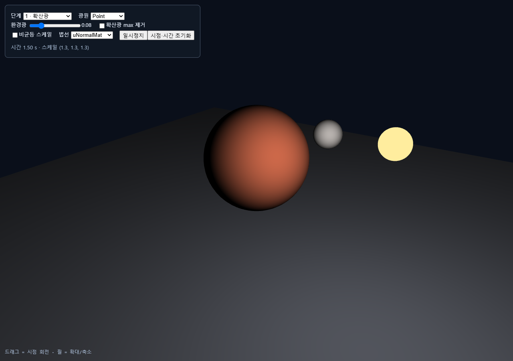
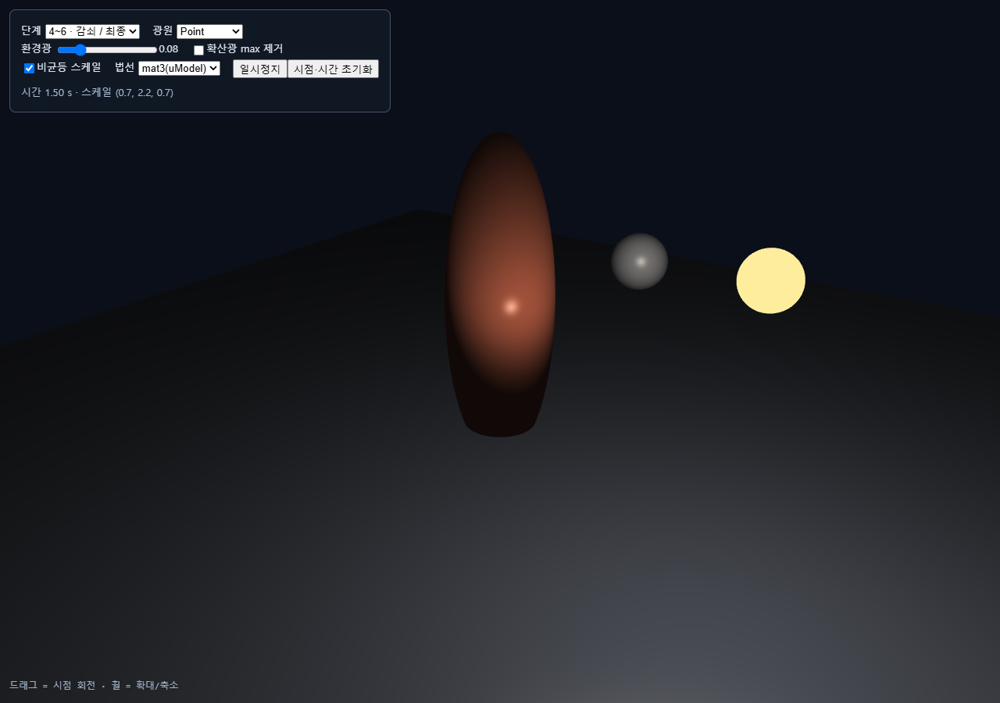
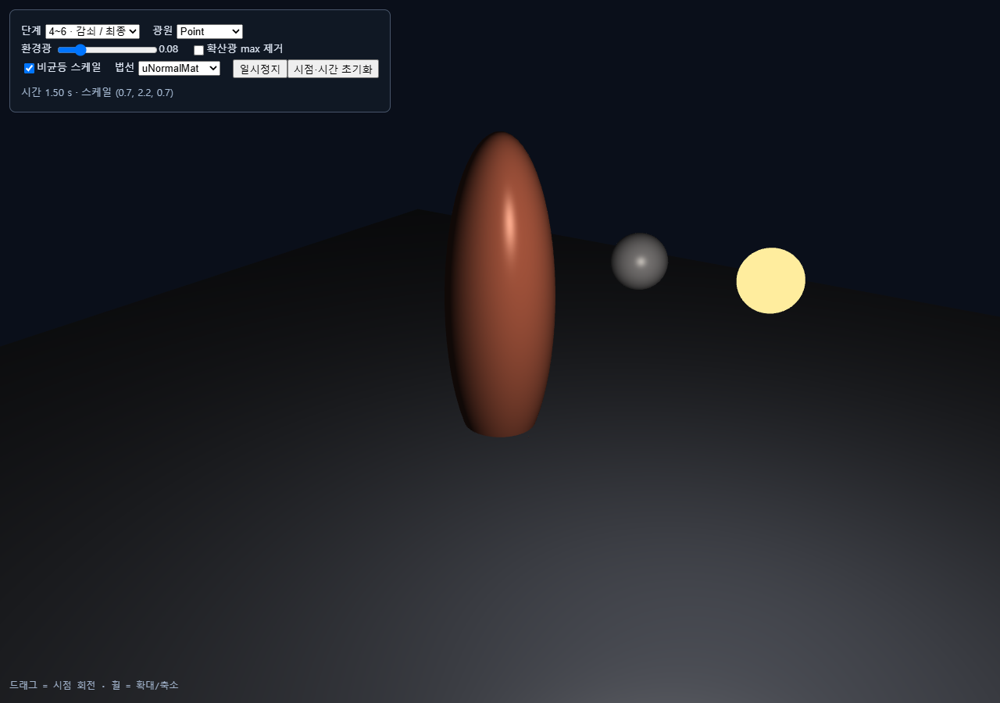

# 5주차 보고서 — 조명과 법선 변환

## 실습 1 — 단계별로 조명 넣기

### 1~4단계 결과

같은 시점과 장면 시간에서 조명을 하나씩 추가해 비교했다.

**1단계 — 확산광**

빛을 받는 면과 받지 않는 면에 명암이 생기면서 평평한 원처럼 보이던 물체가 구처럼 보였다. 이것만 적용해도 기본적인 입체감이 살아난다.

**2단계 — 환경광**

맵 전체에 적용되는 기본 빛이다. 검게 보이던 면에도 물체색이 조금 드러났다. 환경광을 너무 높이면 명암 차이가 줄어 입체감이 약해졌다.

**3단계 — 정반사**

표면에 밝은 하이라이트가 생겼다. 시점을 움직이면 확산광과 달리 하이라이트의 위치가 달라졌다.

**4단계 — 거리 감쇠**

광원에서 먼 부분이 더 어두워졌고, 바닥에도 거리별 밝기 차이가 나타났다.

### max 제거 예측과 결과

**예측:** 빛을 등진 면의 확산광이 음수가 되지만, 화면에서는 음수가 검게 처리되므로 큰 차이가 없을 것으로 예상했다.

**결과:** 밝은 면은 유지되고 반대쪽은 여전히 검게 보였다. 다만 환경광과 함께 계산하면 음수 확산광이 환경광을 상쇄할 수 있으므로, 어두운 면이 의도보다 더 어두워진다. 따라서 현실성을 위해 max를 복구했다.

### 5단계 — 법선 변환 비교

행성을 세로로 늘린 비균등 스케일 `(0.7, 2.2, 0.7)` 상태에서 비교했다. 모델 행렬을 사용하면 법선 방향이 잘못 변해 명암이 달라졌고, 법선 행렬을 사용하면 표면에 맞는 명암과 하이라이트가 나타났다.

**모델 행렬 사용 — mat3(uModel)**

**법선 행렬 사용 — uNormalMat**

### 6단계 — 광원 종류 비교

Point는 광원까지의 방향과 거리에 따라 바닥의 밝기가 달라졌다. Directional은 빛의 방향이 일정하고 거리 감쇠가 없어 바닥의 확산광이 균일해졌다. Spot은 아래쪽의 제한된 영역만 비춰 바닥에 원형의 밝은 부분이 생겼으며, 화면에서는 원근 때문에 타원처럼 보였다.

**Directional**

**Spot**

## 실습 2 — UFO납치와 SOS

### 의도

행성 위의 UFO가 작은 대상을 끌어올리고, 대상이 빨간 SOS 신호로 구조를 요청하는 장면을 만들고자 했다. 따뜻한 태양빛과 차가운 파란 빔을 대비시키고, 깜빡이는 빨간빛으로 위급함을 표현했다.

### 방법

광원은 총 3개를 사용했다. 숫자 키 1, 2, 3으로 각각 켜고 끌 수 있다.

| 광원 | 종류·색 | 위치와 역할 |
| :--- | :--- | :--- |
| 태양 | Point · 오렌지 | 장면 한쪽의 `(-9, 7, -5)`에 고정하고, 거리 감쇠를 적용해 전체를 따뜻하게 비췄다. |
| UFO | Spot · 파랑 | 공전하는 작은 행성의 수직 위에서 아래를 비추도록 했다. 반투명 원뿔대를 더해 공중의 빔도 보이게 했다. |
| SOS | Point · 빨강 | 행성에서 UFO로 상승하는 대상에 배치하고, SOS 모스부호에 맞춰 점멸하게 했다. |

큰 행성은 초록색에 shininess 24로 부드러운 반사를, 작은 행성은 회색에 shininess 100으로 강하고 좁은 반사를 주었다. UFO는 구를 세로로 1/4 압축해 원반 모양으로 만들었고, SOS 대상과 함께 표면 명암을 더해 입체감을 표현했다.

### 최종 결과와 광원별 비교

같은 장면에서 일시정지한 뒤 광원만 바꾸어 비교했다. SOS는 신호가 켜진 순간을 기준으로 했다.

**최종 — 모든 광원 ON**

**태양만 OFF:** 바닥의 따뜻한 빛이 사라지고 파란 빔과 빨간 신호가 더 두드러졌다.

**UFO만 OFF:** 파란 빔과 바닥의 파란 조명 영역이 사라져 납치 장면의 느낌이 약해졌다.

**SOS만 OFF:** 대상의 밝은 빨간빛과 주변의 붉은 반사광이 사라져 구조 신호가 드러나지 않았다.

### AI 활용과 수정

AI에게 실습 1의 코드를 바탕으로 태양, UFO, 납치 타겟을 구현하도록 주문했으며, 그 과정에서 UFO의 광원을 단순 Spotlight로 표현하는 것이 너무 밋밋해서 원뿔대 모양의 메쉬를 하나 추가하도록 수정했다.
또한 이후 AI가 UFO를 구형이 아닌 상하를 1/4로 줄인 접시형을 제안해 해당 제안을 수락해 최종 UFO씬이 완성되었다.