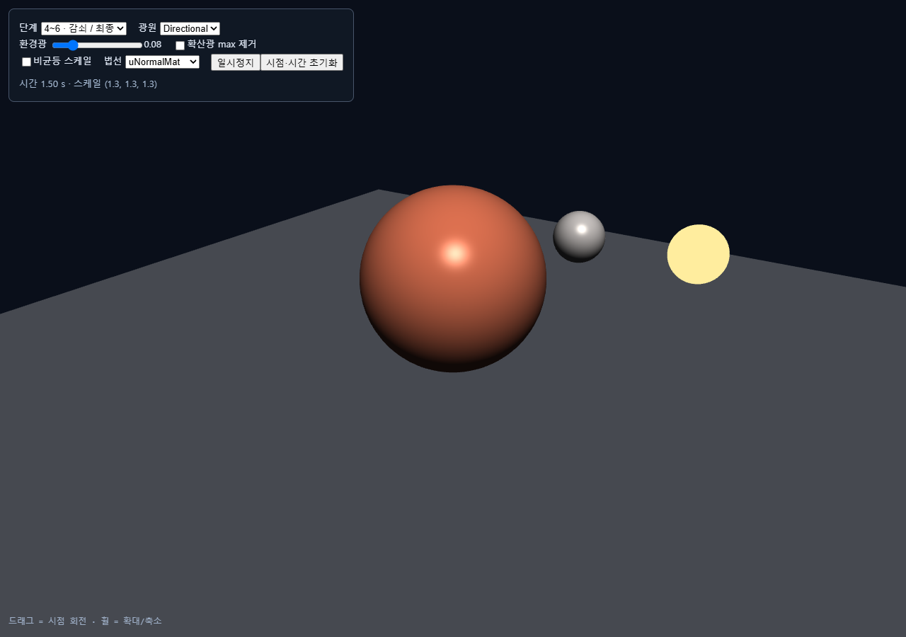

# 5주차 보고서 — 조명과 법선 변환

## 실습 1 — 단계별로 조명 넣기

### 실행 방법과 비교 조건

`task1.html`을 WebGL2 지원 브라우저에서 연다. 기본 상태는 확산광·환경광·정반사·거리 감쇠와 올바른 법선 행렬을 적용한 Point 광원이다. 상단에서 단계, 광원 종류, 환경광 세기, max 제거, 비균등 스케일, 법선 변환을 선택할 수 있다. 드래그로 시점을 회전하고 휠로 확대·축소한다. 일시정지 후 설정을 바꾸면 같은 시간의 장면을 비교할 수 있다.

아래 캡처는 모두 **1280 × 900, yaw = 0.6, pitch = 0.42, 거리 = 11, 장면 시간 = 1.50초**로 고정했다. 단계 1~4는 동일한 Point 광원, 균등 스케일, 환경광 계수 0.08을 사용한다. 단계 5만 행성을 비균등 스케일로 바꾸며, 단계 6은 광원 종류를 변경한다.

### 0단계 — 왜 구가 원처럼 보이는가?

모든 픽셀을 `uBaseColor`로 출력하면 표면의 방향에 따른 명암 변화가 사라진다. 따라서 화면에는 구의 원형 윤곽만 남아 평평한 원처럼 보인다. 구의 곡면을 인지하려면 픽셀마다 표면 법선과 광원 방향에 따라 **반사광의 밝기**가 달라져야 한다. 정반사까지 고려하면 시선 방향도 밝기에 영향을 준다.

### 1단계 — 확산 반사

```glsl
vec3 diffuse = max(dot(N, L), 0.0) * uBaseColor * uLightColor;
fragColor = vec4(diffuse, 1.0);
```

법선 N과 광원 방향 L이 나란할수록 내적이 커져 밝아진다. 빛을 등지는 부분은 0이 되어 검게 보이고, 명암의 연속적인 변화로 곡면이 드러난다.


**max 제거 예측:** `max(dot(N, L), 0.0)`을 `dot(N, L)`로 바꾸면 빛을 등지는 면의 확산광이 음수가 된다. 다만 이 단계는 확산광만 출력하므로 일반적인 화면 출력에서 음수 채널이 0으로 제한되어, 검은 면이 눈에 띄게 달라지지 않을 것으로 예상할 수 있다. `max`만 문자 그대로 삭제해 `(dot(N, L), 0.0)`을 남기는 것이 아니라 내적 자체를 사용한다.

**실제 결과:** max 제거 상태에서도 밝은 면은 유지되고 빛을 등지는 면은 검게 나타났다. 음수 빛을 그대로 표현하는 것이 아니라 출력 범위에서 잘리기 때문이다. 환경광 등 다른 항과 합산할 때는 음수 확산광이 그 항을 상쇄할 수 있으므로, 물리적으로 의미 있는 확산 반사량을 얻기 위해 max를 유지해야 한다. 제출 기본 상태는 max를 복원했다.

**시점 회전:** 확산광은 N과 L만 사용하므로 카메라를 움직인다고 빛을 받는 위치가 카메라를 따라 바뀌지는 않는다. 화면에 보이는 면은 달라지지만 밝은 영역은 세계 좌표의 광원과 표면 방향으로 정해진다. 광원 자체는 시간에 따라 이동하므로 이 차이를 확인할 때는 일시정지해야 한다.

### 2단계 — 환경광

```glsl
vec3 ambient = 0.08 * uBaseColor;
fragColor = vec4(ambient + diffuse, 1.0);
```

완전히 검던 면에도 기본색이 약하게 남는다. 계수가 0.0이면 확산광만 있을 때와 같고, 0.4로 높이면 어두운 면까지 밝아진다. 방향과 무관한 밝기가 커지면서 밝은 면과 어두운 면 사이의 상대적인 대비가 줄어 입체감이 약해진다.


### 3단계 — 정반사

```glsl
vec3 R = reflect(-L, N);
vec3 specular = pow(max(dot(R, V), 0.0), uShininess)
              * uLightColor * 0.5;
fragColor = vec4(ambient + diffuse + specular, 1.0);
```

행성과 달에 밝은 하이라이트가 추가된다. 확산광과 달리 V가 포함되므로 시점을 돌리면 하이라이트가 표면 위에서 이동한다. 행성의 shininess는 32, 달은 16이며, 같은 조건에서 값이 클수록 하이라이트가 좁고 뚜렷해진다. 바닥은 8을 사용한다.


### 4단계 — 거리 감쇠

```glsl
float d = length(uLightPos - vWorldPos);
float att = 1.0 / (1.0 + 0.02 * d * d);
fragColor = vec4(ambient + (diffuse + specular) * att, 1.0);
```

광원에서 멀어질수록 직접광인 확산광과 정반사가 약해진다. 바닥에도 위치에 따른 밝기 차이가 생긴다. 환경광은 특정 광원과의 거리로 정하는 항이 아니므로 att를 곱하지 않았다.


### 5단계 — 비균등 스케일과 법선 행렬

행성의 스케일을 `(0.7, 2.2, 0.7)`로 바꾸고 동일한 시점·시간·광원에서 비교했다. 원래 중심 높이 1.6을 유지했으므로 늘어난 행성의 아래쪽 일부는 바닥과 교차한다.

**모델 행렬로 법선 변환 — 잘못된 결과**

```glsl
vNormal = mat3(uModel) * aNormal;
```


**역전치 법선 행렬로 변환 — 올바른 결과**

```glsl
vNormal = uNormalMat * aNormal;
```


비균등 스케일에서 모델 행렬을 그대로 곱하면 법선도 긴 축 방향으로 과도하게 기울어 표면에 수직인 방향을 유지하지 못한다. 두 이미지에서 밝은 영역과 하이라이트의 위치·모양이 달라진다. 법선에는 모델 행렬의 좌상단 3×3의 역전치 행렬을 적용하고, 프래그먼트 셰이더에서 정규화한다. 균등 스케일에서는 정규화 후 방향이 같아 차이가 없다.

출발 파일의 `normalFromMat4`는 역행렬을 반환하는 배열 배치였으므로, 반환 원소를 전치하여 실제 역전치 행렬이 되도록 수정했다. 단순 대각 스케일만 아니라 회전과 스케일이 함께 있을 때도 올바르게 동작하도록 한 것이다.

### 6단계 — Point / Directional / Spot 비교

#### Point

```glsl
vec3 L = normalize(uLightPos - vWorldPos);
```

#### Directional

```glsl
vec3 L = normalize(vec3(0.4, 0.8, 0.5));
```



#### Spot

광원 위치는 `(2.8, 5.0, 0.0)`, 조사 방향은 `(0, -1, 0)`으로 정했다. 안쪽 반각은 18°, 바깥쪽 반각은 25°이며, 사이를 smoothstep으로 보간한다.

```glsl
float theta = dot(-L, normalize(uSpotDirection));
float cone = smoothstep(cos(radians(25.0)), cos(radians(18.0)), theta);
fragColor = vec4(ambient + (diffuse + specular) * att * cone, 1.0);
```


Point는 표면 위치마다 광원까지의 방향과 거리가 달라 바닥의 밝기가 연속적으로 달라진다. Directional은 모든 위치에서 같은 방향을 사용하고 거리 감쇠도 적용하지 않으므로 평평한 바닥의 **확산광 성분**이 균일해진다. 다만 정반사는 시선 방향에 의존해 최종 바닥 전체가 완전히 같은 색이 되는 것은 아니다. Spot은 Point의 방향·거리 계산에 원뿔 범위 제한을 더하므로 바닥의 한정된 원형 영역만 직접광을 받으며, 카메라의 원근 투영 때문에 화면에서는 타원처럼 보인다. 원뿔 밖에는 환경광만 남는다. Directional 선택 시 노란 구는 실제 유한 거리의 광원이 아니라 기존 위치 표시용 구이며 조명 방향은 고정 벡터로 결정된다. 이 실습은 그림자 가림 계산을 포함하지 않는다.

### 구현 및 검증

- 외부 라이브러리 없이 WebGL2로 구현했다.
- 기본값: 4단계까지 누적 적용, Point, 환경광 0.08, 균등 스케일, 올바른 법선 행렬.
- 모든 단계와 광원 종류를 Chrome의 WebGL2에서 렌더링하고 캡처했다.
- 캡처 중 JavaScript 오류가 없었고 WebGL 오류 코드는 0이었다.
- 제출용 이미지 8장은 `images/`에 저장했다.
- 과제 안내의 [강의 자료 4-3](https://cg.catholic.ac.kr/~mgchoi/CG/weeks/week05/#4-3)은 접근을 시도했으나 가져오지 못했다. Spot은 위에 명시한 원뿔 내적과 부드러운 경계 방식으로 구현했다.

## 실습 2 — 빛으로 분위기 만들기

추후 작성.
