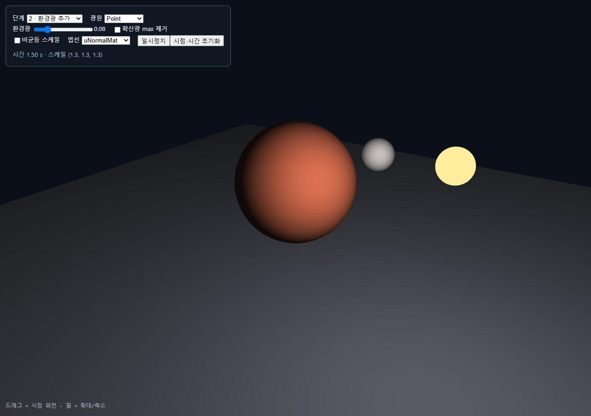
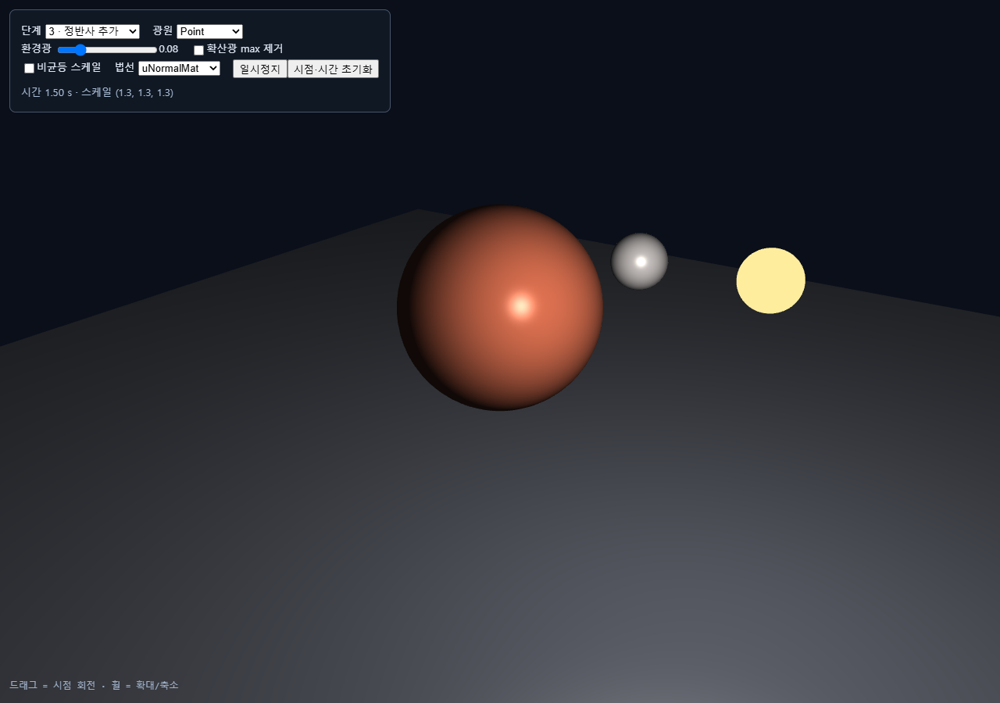
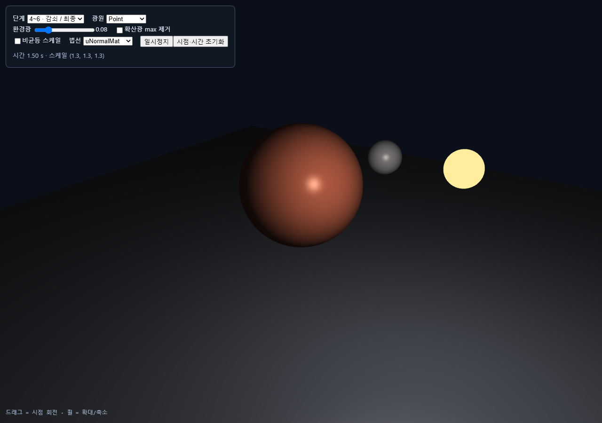
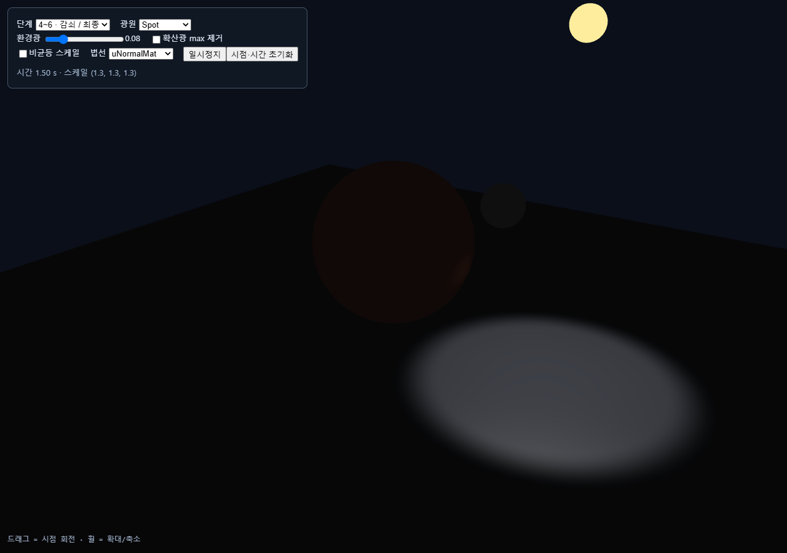
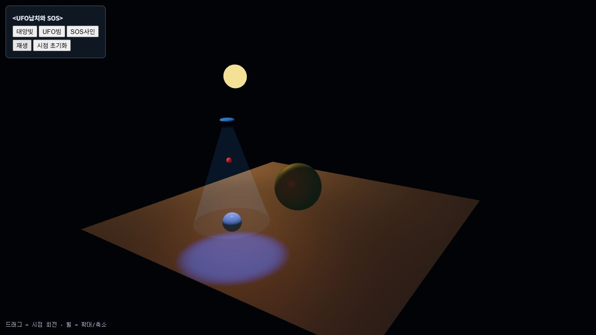
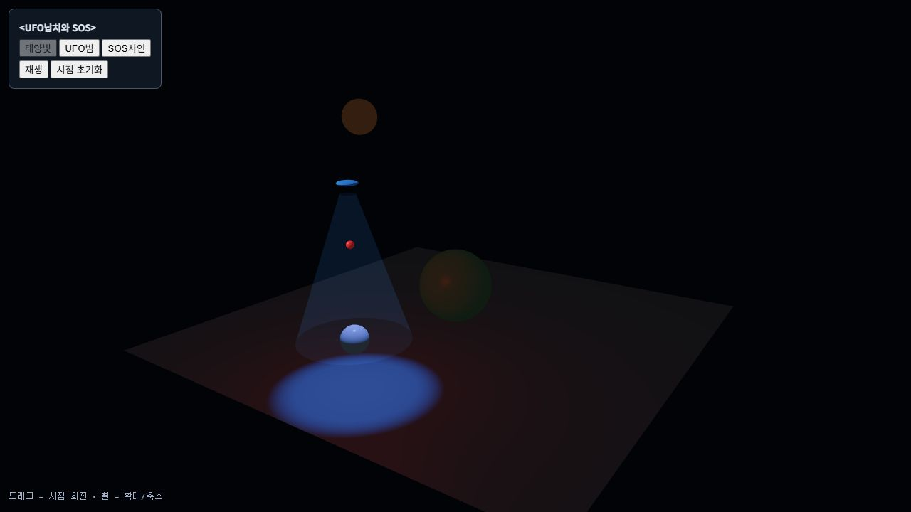
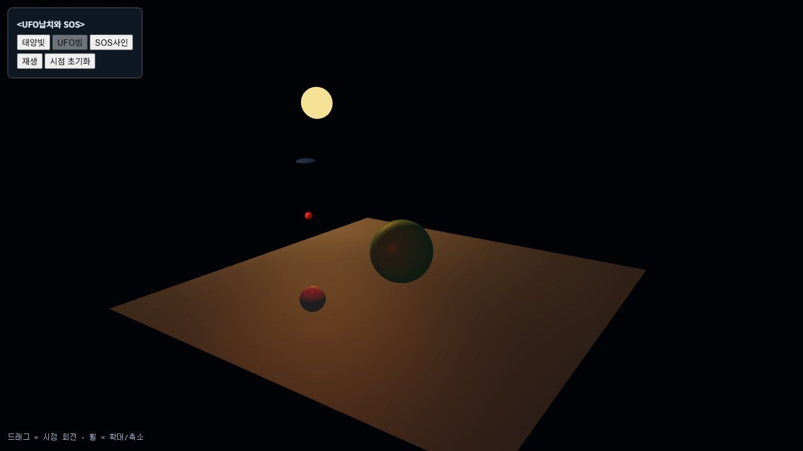

# 5주차 보고서 — 조명과 법선 변환

## 실습 1 — 단계별로 조명 넣기

### 실행 방법과 비교 조건

`task1.html`을 WebGL2 지원 브라우저에서 연다. 기본 상태는 확산광·환경광·정반사·거리 감쇠와 올바른 법선 행렬을 적용한 Point 광원이다. 상단에서 단계, 광원 종류, 환경광 세기, max 제거, 비균등 스케일, 법선 변환을 선택할 수 있다. 드래그로 시점을 회전하고 휠로 확대·축소한다. 일시정지 후 설정을 바꾸면 같은 시간의 장면을 비교할 수 있다.

아래 캡처는 모두 **1280 × 900, yaw = 0.6, pitch = 0.42, 거리 = 11, 장면 시간 = 1.50초**로 고정했다. 단계 1~4는 동일한 Point 광원, 균등 스케일, 환경광 계수 0.08을 사용한다. 단계 5만 행성을 비균등 스케일로 바꾸며, 단계 6은 광원 종류를 변경한다.

### 0단계 — 왜 구가 원처럼 보이는가?

모든 픽셀을 `uBaseColor`로 출력하면 표면의 방향에 따른 명암 변화가 사라진다. 따라서 화면에는 구의 원형 윤곽만 남아 평평한 원처럼 보인다. 구의 곡면을 인지하려면 픽셀마다 표면 법선과 광원 방향에 따라 **반사광의 밝기**가 달라져야 한다. 정반사까지 고려하면 시선 방향도 밝기에 영향을 준다.

### 1단계 — 확산 반사

```glsl
vec3 diffuse = max(dot(N, L), 0.0) * uBaseColor * uLightColor;
fragColor = vec4(diffuse, 1.0);
```

법선 N과 광원 방향 L이 나란할수록 내적이 커져 밝아진다. 빛을 등지는 부분은 0이 되어 검게 보이고, 명암의 연속적인 변화로 곡면이 드러난다.


**max 제거 예측:** `max(dot(N, L), 0.0)`을 `dot(N, L)`로 바꾸면 빛을 등지는 면의 확산광이 음수가 된다. 다만 이 단계는 확산광만 출력하므로 일반적인 화면 출력에서 음수 채널이 0으로 제한되어, 검은 면이 눈에 띄게 달라지지 않을 것으로 예상할 수 있다. `max`만 문자 그대로 삭제해 `(dot(N, L), 0.0)`을 남기는 것이 아니라 내적 자체를 사용한다.

**실제 결과:** max 제거 상태에서도 밝은 면은 유지되고 빛을 등지는 면은 검게 나타났다. 음수 빛을 그대로 표현하는 것이 아니라 출력 범위에서 잘리기 때문이다. 환경광 등 다른 항과 합산할 때는 음수 확산광이 그 항을 상쇄할 수 있으므로, 물리적으로 의미 있는 확산 반사량을 얻기 위해 max를 유지해야 한다. 제출 기본 상태는 max를 복원했다.

**시점 회전:** 확산광은 N과 L만 사용하므로 카메라를 움직인다고 빛을 받는 위치가 카메라를 따라 바뀌지는 않는다. 화면에 보이는 면은 달라지지만 밝은 영역은 세계 좌표의 광원과 표면 방향으로 정해진다. 광원 자체는 시간에 따라 이동하므로 이 차이를 확인할 때는 일시정지해야 한다.

### 2단계 — 환경광

```glsl
vec3 ambient = 0.08 * uBaseColor;
fragColor = vec4(ambient + diffuse, 1.0);
```

완전히 검던 면에도 기본색이 약하게 남는다. 계수가 0.0이면 확산광만 있을 때와 같고, 0.4로 높이면 어두운 면까지 밝아진다. 방향과 무관한 밝기가 커지면서 밝은 면과 어두운 면 사이의 상대적인 대비가 줄어 입체감이 약해진다.



### 3단계 — 정반사

```glsl
vec3 R = reflect(-L, N);
vec3 specular = pow(max(dot(R, V), 0.0), uShininess)
              * uLightColor * 0.5;
fragColor = vec4(ambient + diffuse + specular, 1.0);
```

행성과 달에 밝은 하이라이트가 추가된다. 확산광과 달리 V가 포함되므로 시점을 돌리면 하이라이트가 표면 위에서 이동한다. 행성의 shininess는 32, 달은 16이며, 같은 조건에서 값이 클수록 하이라이트가 좁고 뚜렷해진다. 바닥은 8을 사용한다.



### 4단계 — 거리 감쇠

```glsl
float d = length(uLightPos - vWorldPos);
float att = 1.0 / (1.0 + 0.02 * d * d);
fragColor = vec4(ambient + (diffuse + specular) * att, 1.0);
```

광원에서 멀어질수록 직접광인 확산광과 정반사가 약해진다. 바닥에도 위치에 따른 밝기 차이가 생긴다. 환경광은 특정 광원과의 거리로 정하는 항이 아니므로 att를 곱하지 않았다.



### 5단계 — 비균등 스케일과 법선 행렬

행성의 스케일을 `(0.7, 2.2, 0.7)`로 바꾸고 동일한 시점·시간·광원에서 비교했다. 원래 중심 높이 1.6을 유지했으므로 늘어난 행성의 아래쪽 일부는 바닥과 교차한다.

**모델 행렬로 법선 변환 — 잘못된 결과**

```glsl
vNormal = mat3(uModel) * aNormal;
```


**역전치 법선 행렬로 변환 — 올바른 결과**

```glsl
vNormal = uNormalMat * aNormal;
```


비균등 스케일에서 모델 행렬을 그대로 곱하면 법선도 긴 축 방향으로 과도하게 기울어 표면에 수직인 방향을 유지하지 못한다. 두 이미지에서 밝은 영역과 하이라이트의 위치·모양이 달라진다. 법선에는 모델 행렬의 좌상단 3×3의 역전치 행렬을 적용하고, 프래그먼트 셰이더에서 정규화한다. 균등 스케일에서는 정규화 후 방향이 같아 차이가 없다.

출발 파일의 `normalFromMat4`는 역행렬을 반환하는 배열 배치였으므로, 반환 원소를 전치하여 실제 역전치 행렬이 되도록 수정했다. 단순 대각 스케일만 아니라 회전과 스케일이 함께 있을 때도 올바르게 동작하도록 한 것이다.

### 6단계 — Point / Directional / Spot 비교

#### Point

```glsl
vec3 L = normalize(uLightPos - vWorldPos);
```

#### Directional

```glsl
vec3 L = normalize(vec3(0.4, 0.8, 0.5));
```


#### Spot

광원 위치는 `(2.8, 5.0, 0.0)`, 조사 방향은 `(0, -1, 0)`으로 정했다. 안쪽 반각은 18°, 바깥쪽 반각은 25°이며, 사이를 smoothstep으로 보간한다.

```glsl
float theta = dot(-L, normalize(uSpotDirection));
float cone = smoothstep(cos(radians(25.0)), cos(radians(18.0)), theta);
fragColor = vec4(ambient + (diffuse + specular) * att * cone, 1.0);
```



Point는 표면 위치마다 광원까지의 방향과 거리가 달라 바닥의 밝기가 연속적으로 달라진다. Directional은 모든 위치에서 같은 방향을 사용하고 거리 감쇠도 적용하지 않으므로 평평한 바닥의 **확산광 성분**이 균일해진다. 다만 정반사는 시선 방향에 의존해 최종 바닥 전체가 완전히 같은 색이 되는 것은 아니다. Spot은 Point의 방향·거리 계산에 원뿔 범위 제한을 더하므로 바닥의 한정된 원형 영역만 직접광을 받으며, 카메라의 원근 투영 때문에 화면에서는 타원처럼 보인다. 원뿔 밖에는 환경광만 남는다. Directional 선택 시 노란 구는 실제 유한 거리의 광원이 아니라 기존 위치 표시용 구이며 조명 방향은 고정 벡터로 결정된다. 이 실습은 그림자 가림 계산을 포함하지 않는다.

### 구현 및 검증

- 외부 라이브러리 없이 WebGL2로 구현했다.
- 기본값: 4단계까지 누적 적용, Point, 환경광 0.08, 균등 스케일, 올바른 법선 행렬.
- 모든 단계와 광원 종류를 Chrome의 WebGL2에서 렌더링하고 캡처했다.
- 캡처 중 JavaScript 오류가 없었고 WebGL 오류 코드는 0이었다.
- 제출용 이미지 8장은 `images/`에 저장했다.
- 과제 안내의 [강의 자료 4-3](https://cg.catholic.ac.kr/~mgchoi/CG/weeks/week05/#4-3)은 접근을 시도했으나 가져오지 못했다. Spot은 위에 명시한 원뿔 내적과 부드러운 경계 방식으로 구현했다.

## 실습 2 — 빛으로 분위기 만들기

### 제목과 의도 — UFO납치와 SOS

평온하게 공전하던 행성 위에 UFO가 나타나 작은 대상을 끌어올리고, 대상이 붉은 SOS 신호로 구조를 요청하는 장면을 만들고자 했다. 멀리 있는 따뜻한 태양빛과 UFO의 차가운 파란 빛을 대비시키고, 그 사이에서 깜빡이는 빨간빛으로 위급함을 표현했다. 실습 1의 바닥과 두 구를 유지하면서 조명과 재질을 중심으로 장면의 인상을 바꾸었다.

### 실행과 조작

`task2.html`을 WebGL2 지원 브라우저에서 연다. 기본 상태에서는 광원 세 개가 모두 켜져 있으며, 작은 회색 행성과 UFO가 함께 공전하고 빨간 대상이 상승한다.

| 조작 | 기능 |
| :--- | :--- |
| `1` / 태양빛 버튼 | 오렌지색 태양 Point 광원 켜기·끄기 |
| `2` / UFO빔 버튼 | 파란 Spot 광원과 반투명 빔 켜기·끄기 |
| `3` / SOS사인 버튼 | 빨간 Point 광원과 밝은 SOS 발광 켜기·끄기 |
| `Space` / 재생·일시정지 버튼 | 공전·상승·점멸을 함께 정지하거나 재생 |
| 시점 초기화 | 카메라만 초기화하며 장면 시간은 유지 |
| 드래그 / 휠 | 카메라 회전 / 확대·축소 |

키보드 단축키는 버튼에 포커스가 없는 상태에서 사용한다. 광원이 꺼지면 해당 버튼이 흐리게 표시된다.

### 방법 — 광원 세 개의 역할

아래 RGB 값은 세기를 포함하는 선형 조명 값이므로 1보다 큰 성분도 사용한다. `d`는 표면에서 해당 광원까지의 거리이다.

| 광원 | 종류 | 위치·방향 | RGB와 감쇠 | 담당하는 효과 |
| :--- | :--- | :--- | :--- | :--- |
| 태양 | Point | `(-9, 7, -5)`에 고정 | `(10, 3.1, 0.45)`, `1 / (1 + 0.06*d*d)` | 바닥과 행성에 넓고 따뜻한 빛을 주며 거리에 따라 밝기가 줄어듦 |
| UFO | Spot | 회색 행성과 같은 x·z, 높이 `6.1`, 방향 `(0, -1, 0)` | `(0.12, 1.6, 7)`, `1 / (1 + 0.055*d*d)` | 회색 행성과 바닥 일부만 파랗게 비추어 납치 위치를 강조 |
| SOS | Point | 상승하는 빨간 구의 중심 | `(9, 0.08, 0.025)`, `1 / (1 + 3*d*d)`에 점멸값을 곱함 | 주변 표면에 국소적인 붉은 반사광을 만들고 구조 신호를 전달 |

태양은 Directional 대신 유한 거리에 있는 Point로 구현했다. 장면 한쪽에 고정한 자체발광 구의 중심과 실제 광원 위치를 일치시켰고, 거리 감쇠를 통해 가까운 곳과 먼 곳의 차이가 드러나게 했다. 태양 표시 구는 표면 조명을 계산하지 않으므로 빛을 등진 어두운 면이 생기지 않는다. 태양을 끄면 표시 구도 어두워진다.

UFO의 Spot은 광원에서 표면으로 향하는 방향과 아래쪽 축의 내적으로 조사 범위를 계산한다. 안쪽 반각은 15°, 바깥쪽 반각은 23°이며 그 사이를 `smoothstep`으로 연결한다.

```glsl
float cone = smoothstep(cos(radians(23.0)), cos(radians(15.0)),
                        dot(-L, vec3(0, -1, 0)));
```

Spot 조명만으로는 공중의 빛줄기가 보이지 않으므로, 별도의 반투명 원뿔대 메시를 더했다. 원뿔대는 높이 4.2, 아래 반지름 1.65, 위 반지름 0.22이며 알파값 0.075로 가산 합성한다. 이것은 납치 빔을 보여 주는 연출이고 실제 체적 산란 계산은 아니다. 빔을 그릴 때 깊이 검사는 유지하고 깊이 쓰기만 꺼서 불투명 물체와 함께 표현한다. 실제 바닥의 파란 조명 영역은 Spot 계산으로 만든다.

### 재질과 움직임

| 물체 | 기본색 RGB | `shininess` | 정반사 세기 `ks` | 의도 |
| :--- | :--- | ---: | ---: | :--- |
| 큰 행성 | `(0.12, 0.42, 0.16)` | 24 | 0.25 | 초록색이며 비교적 부드럽고 넓은 반사 |
| 작은 행성 | `(0.52, 0.52, 0.52)` | 100 | 0.85 | 회색이며 좁고 강한 하이라이트 |
| 바닥 | `(0.12, 0.14, 0.20)` | 12 | 0.12 | 광원 색과 조사 범위를 읽기 위한 어두운 표면 |

작은 행성의 공전 반지름은 5.6, 각속도는 초당 0.16라디안이다. UFO와 빨간 대상은 이 행성의 x·z 좌표를 공유하므로 항상 수직 위에 위치한다. UFO는 구 메시의 가로 반지름 0.30을 유지하고 세로 반지름만 0.075로 압축해 원반처럼 만들었다. 비균등 스케일에 맞춰 법선은 역전치 행렬로 변환한다.

빨간 대상은 반지름 0.115의 구이며, 18초 주기 중 처음 15초 동안 높이 2.10에서 5.75까지 상승하고 나머지 3초는 사라진 뒤 다시 시작한다. 점멸은 `··· ─── ···` 순서로, 점 1단위·선 3단위·부호 사이 1단위·문자 사이 3단위·반복 사이 7단위를 사용한다. 1단위는 0.18초이며, 밝은 구 표시와 실제 빨간 Point 광원이 함께 점멸한다. 대상이 사라지는 동안에는 신호도 꺼진다.

UFO와 SOS를 균일한 자체발광 색으로만 그리면 평평해 보였으므로, 두 표시 물체에는 별도의 연출용 표면 명암과 하이라이트를 넣었다. 고정 방향 `(-0.6, 0.8, 0.7)`을 정규화하여 명암을 만들고 최소 발광을 남겼다. 이것은 주변 물체를 비추는 실제 광원 계산과 구분되는 시각적 보조 표현이며, 태양 표시 구와 빔에는 적용하지 않는다.

### 조명 합성과 화면 출력

일반 표면은 `0.018 * uBaseColor`의 환경광을 한 번만 더하고, 켜진 광원마다 `shade()`로 계산한 확산광과 정반사를 누적한다. 정반사는 빛을 향하는 면에서만 계산하며, 환경광에는 거리 감쇠나 Spot 범위 제한을 곱하지 않는다. 마지막에 아래 톤 매핑과 감마 보정을 적용한다.

```glsl
color = color / (color + vec3(1.0));
color = pow(max(color, vec3(0.0)), vec3(1.0 / 2.2));
```

밝은 광원 색의 차이를 유지하면서 출력 범위로 압축하고, 화면에서 어두운 부분의 구분이 가능하도록 했다. 이 장면에는 물체가 빛을 가리는 그림자 계산은 포함하지 않았다.

### 최종 결과와 광원별 비교

아래 네 장은 같은 카메라와 같은 장면 시간에서 일시정지한 뒤 광원만 바꾸어 캡처했다. 카메라는 기본값인 yaw 0.6, pitch 0.28, 거리 22이며, 캡처 크기는 1280 × 720이다. SOS는 켜진 순간을 선택하여 광원을 껐을 때와의 차이를 비교했다. 이미지에서 흐리게 보이는 버튼이 꺼진 광원이다.

#### 최종 — 모든 광원 ON

따뜻한 태양빛이 전체 배경을 만들고, 파란 원뿔대와 바닥의 조사 영역이 납치 위치를 드러낸다. 그 안에서 상승하는 빨간 대상과 주변의 붉은 반사광이 구조 요청을 강조한다.



#### 태양만 OFF

바닥의 넓은 오렌지색 조명과 큰 행성의 밝은 가장자리가 사라진다. 파란 빔과 빨간 신호가 상대적으로 두드러지며 장면이 훨씬 어둡고 고립된 느낌으로 바뀐다. 태양이 전체적인 공간과 따뜻한 색조를 담당한다는 것을 확인할 수 있다.



#### UFO만 OFF

공중의 파란 빔과 바닥의 파란 조사 영역이 사라지고, 회색 행성 위의 파란 하이라이트도 사라진다. 태양빛과 빨간 신호는 남지만 납치 장면의 연결 구조가 약해진다. UFO 조명이 시선을 사건의 중심으로 모으는 역할을 한다.



#### SOS만 OFF

파란 빔과 태양빛은 유지되지만 대상의 밝은 빨간 발광과 주변의 붉은 반사광이 사라진다. 대상 자체는 어두운 구로 남는다. 공간의 밝기 변화보다 긴급한 구조 요청이라는 이야기의 단서가 사라지는 차이가 크다.


### AI 활용과 수정 과정

AI에는 실습 1 코드를 바탕으로 오렌지색 태양빛, 행성의 수직 위에서 함께 공전하는 파란 UFO의 Spot 조명, UFO로 끌려 올라가며 SOS로 점멸하는 빨간 광원을 구현하도록 요청했다. 장면의 주제와 광원별 역할은 직접 정했고, 결과를 보며 아래 내용을 추가로 요구해 수정했다.

- UFO의 받침을 제거하고 크기를 줄인 뒤, 적도 반지름은 유지하면서 위아래만 1/4로 압축했다.
- 처음의 노란 전체 조명을 오렌지색 Point 태양으로 바꾸고 감쇠를 적용했다. 이후 실제 광원 위치에 자체발광 태양 구를 고정해 빛의 출처를 보이게 했다.
- 공전 반지름을 두 배로 늘리고 행성 색을 조정했다. 최종적으로 중앙 행성은 초록, 공전하는 행성은 회색으로 구분했다.
- UFO와 SOS가 평평한 원처럼 보이지 않도록 발광 밝기를 낮추고 표면 명암과 하이라이트를 추가했다.
- 조작부를 제목, 세 광원 버튼, 재생·일시정지와 시점 초기화의 세 줄로 정리하고 부가 상태 문구를 제거했다.

AI가 작성한 결과에서 표시용 발광 물체와 실제 조명 계산을 구분하고, `shade()`의 확산·정반사 합산, 거리 감쇠, Spot의 원뿔 범위, SOS 타이밍과 재질 차이가 각각 어떤 효과를 만드는지 확인했다.

### 확인한 사항

- WebGL2 브라우저에서 두 행성, 태양, 원반형 UFO, 반투명 빔과 상승하는 SOS 대상을 렌더링했다.
- 화면의 세 광원 버튼을 각각 조작하여 조명 변화와 꺼짐 표시를 확인했다.
- 일시정지 상태에서 광원만 바꿔 같은 구도의 비교 이미지 네 장을 저장했다.
- 캡처에 사용한 브라우저 탭에서 수집된 콘솔 오류·경고는 없었다.
- 캡처는 `images/`에 제출용으로 저장했으며, 임시파일은 남기지 않았다.

