# 실습 1 · PBR 재질 적용

## 단계별 비교

같은 시점과 조명에서 녹슨 금속 큐브를 비교했다. 직접광은 4, ambient는 0.15로 고정하고 환경 반사는 껐다.

### 1단계 · 색 텍스처

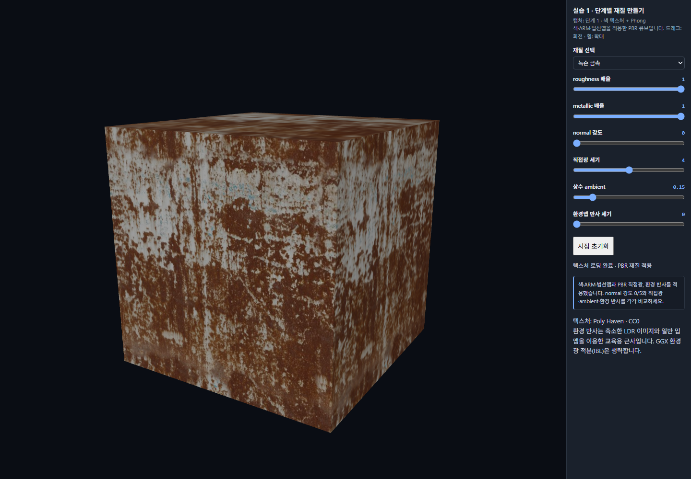

기존 Phong 조명에 색 텍스처를 적용하자 회색 큐브에 녹슨 금속 무늬가 나타났다. 녹과 금속의 색 차이는 있지만, 위치별 거칠기와 금속성은 아직 반영되지 않은 상태다. 색 이미지는 선형 색으로 변환해 사용했으며, 정점 수와 모양은 그대로였다.

### 3단계 · PBR과 위치별 재질

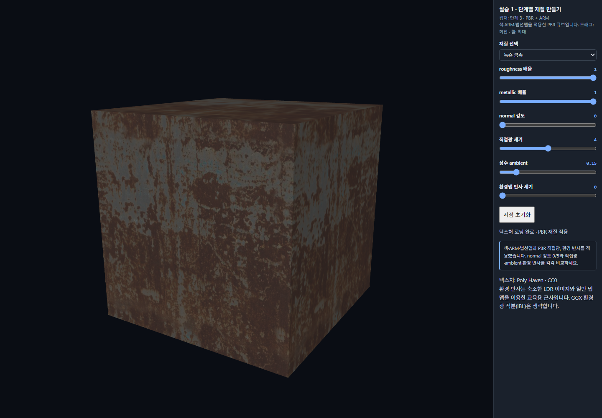

1단계에 2단계의 PBR 조명과 3단계의 ARM 값을 누적 적용했다. 1단계가 색 무늬만 표현했다면, 이 단계에서는 녹과 금속이 빛을 반사하는 방식까지 달라진다. 금속 영역은 금속성이 높아 색이 있는 정반사를 보이고, 녹 영역은 금속성이 낮아 확산 반사 위주로 보인다. 거칠기도 위치마다 달라 표면 전체가 똑같이 반사되지 않는다. 

### 4단계 · 법선맵

3단계의 색·PBR·ARM을 유지하고 법선맵을 추가했다. 같은 시점과 조명에서 법선 강도만 0에서 5로 바꿔 비교했다. 법선맵을 조명 계산에 사용하는 공간으로 변환하자 작은 흠집과 요철에 따른 세부 명암이 생겼다. 실제 정점 위치를 바꾼 것은 아니므로 큐브의 외곽선은 그대로였다.

## 조명 조건 비교

### 모든 광원 끄기

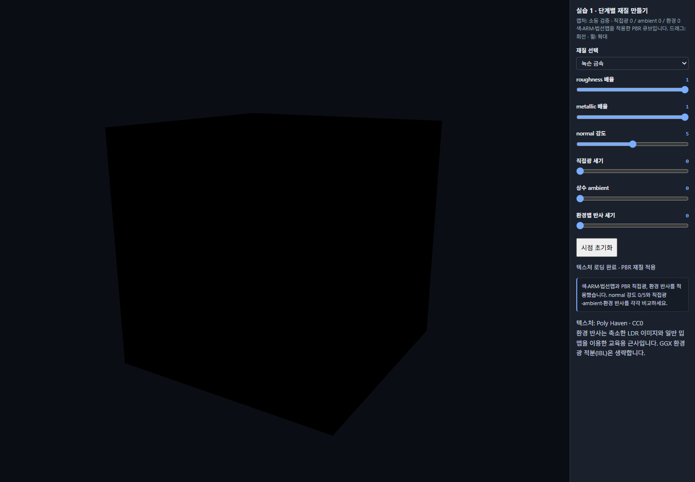

직접광과 ambient를 0으로 두고 환경 반사도 껐다. 큐브가 검게 보여, 비발광 물체는 텍스처가 있어도 빛이 없으면 밝게 보이지 않는 것을 확인했다.

### 환경 반사만 켜기

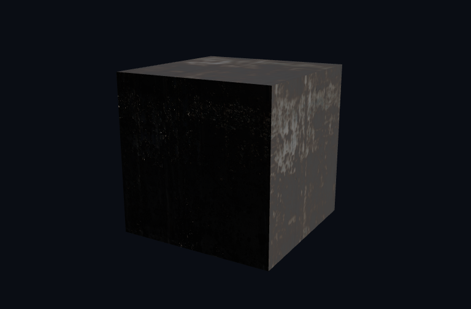

직접광과 ambient를 끄고 환경 반사만 켰다. 주변 환경 이미지가 반사되면서 면과 표면 방향에 따라 밝기가 달라졌다. 직접광이 없어도 환경맵으로 반사가 남는 것을 확인했다.

### 간접광만 켜기

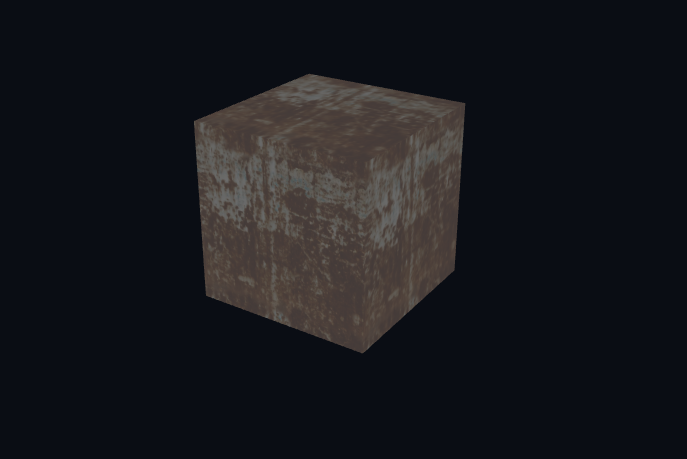

직접광과 환경 반사를 끄고 상수 ambient만 켰다. 환경 이미지의 반사 대신 전체적으로 고른 밝기가 생겨 재질 무늬가 보였다. 이때도 AO와 재질 값에 따라 부분별 밝기는 달랐다. 환경 반사와 상수 간접광이 서로 다른 역할을 한다는 것을 확인했다.

# 실습 2 · 녹슨 금속 행성

## 행성 설정과 두 규칙

이번에 기획한 행성의 컨셉은 녹슨 금속으로 덮인 행성이다. 태양에 가까워지면 해당 지점부터 철이 녹아서 주황색 쇳물로 변하고, 과도하게 행성이 과열되면 자체적으로 행성의 한 지점에서 냉각제를 분사해 행성 전체를 뒤덮게 된다.

| 원인 | 위치별 변화 | 재질 변화 | 코드 위치 (`task2.js`) |
|---|---|---|---|
| 태양 거리 | 가까울수록 태양을 향한 면의 용융 영역 확대 | 주황색, 거칠기 0.16, 금속성 1, 자체 발광 | `meltRegion()` 61행, 실제 거리·위치 연결 242~245행 |
| 페인트 분사량 | 로컬 구면의 한 지점부터 부드러운 경계로 확대 | 하늘색, 거칠기 0.32, 금속성 0 | `paintRegion()` 72행 |

두 마스크를 재질에 연결하는 부분은 111~121행이다. 페인트가 겹친 곳은 금속 위의 도막으로 처리해 용융 발광을 가린다. 실습 1의 ARM과 법선맵도 유지했다.

## 조건별 0·50·100 비교

### 첫 조건 · 태양 거리

페인트는 0으로 고정했다. 슬라이더 0은 가까움(중심 거리 3), 50은 중간(5), 100은 멂(7)이다.

| 거리 0 | 거리 50 | 거리 100 |
|---|---|---|
| 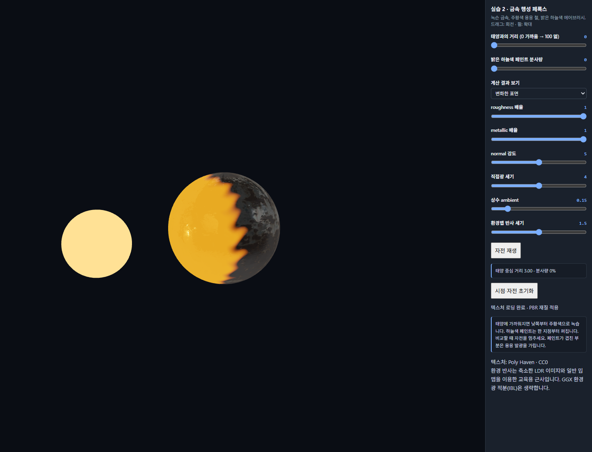 | 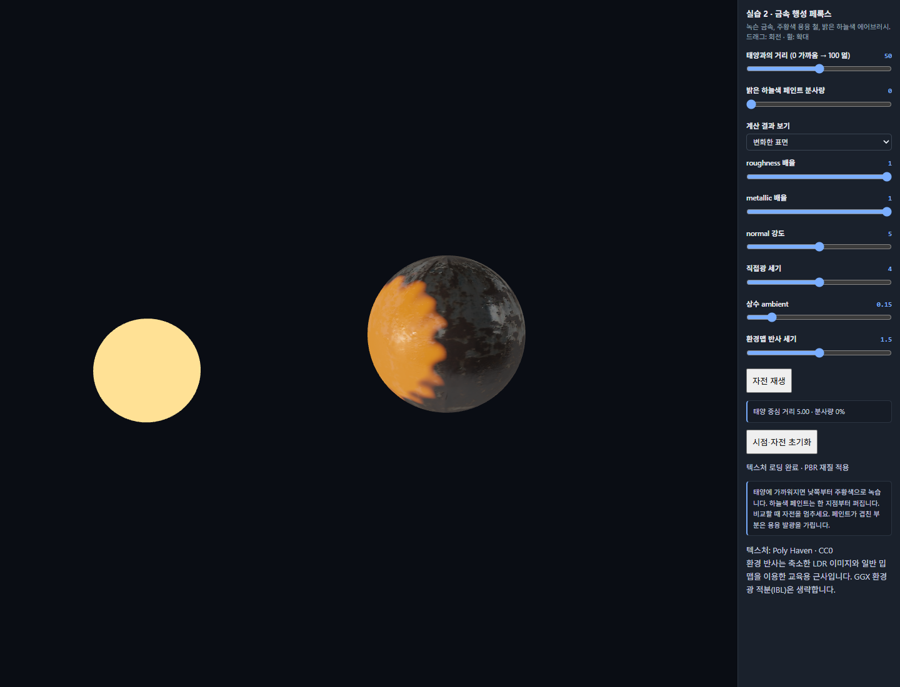 | 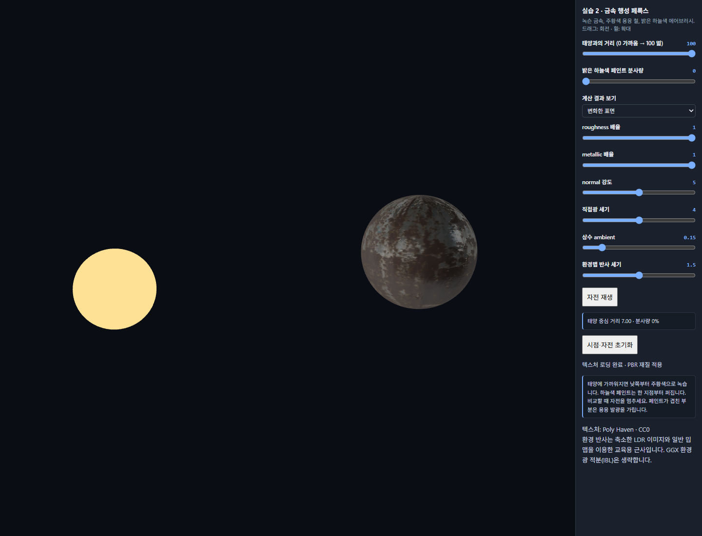 |

태양에 가까울수록 행성이 실제로 이동하고, 받는 직접광과 용융 영역이 커졌다. 멀리 떨어진 100에서는 용융 발광이 사라져 원래의 녹슨 표면이 보였다.

### 둘째 조건 · 페인트 분사량

태양 거리는 50으로 고정했다.

| 분사량 0 | 분사량 50 | 분사량 100 |
|---|---|---|
|  | 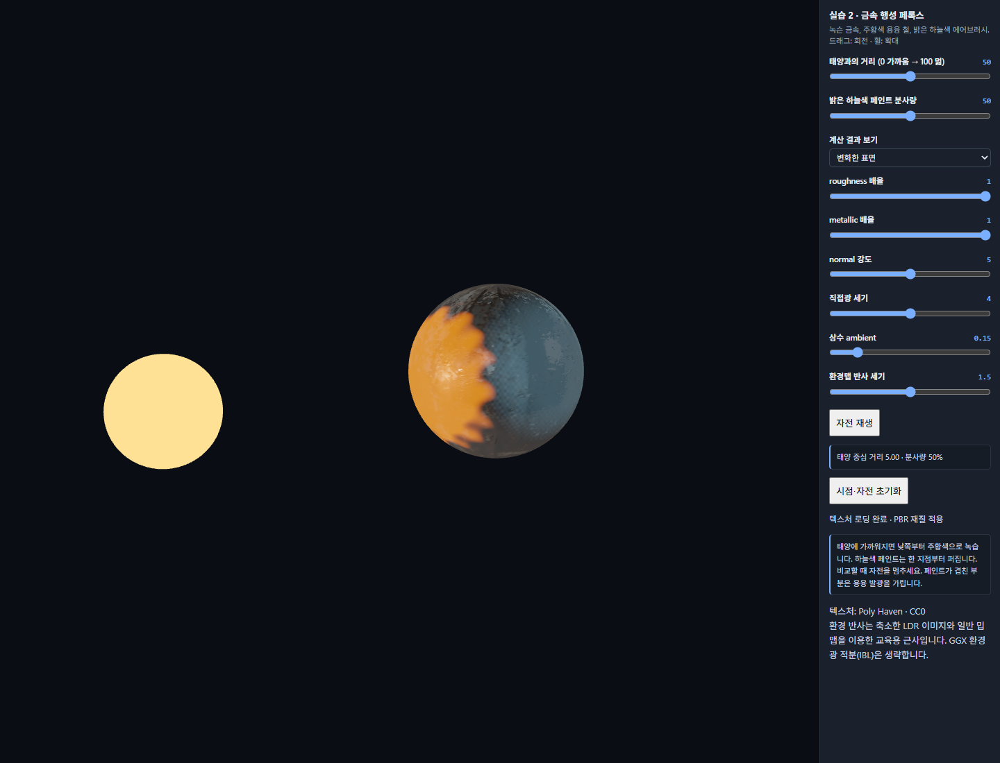 | 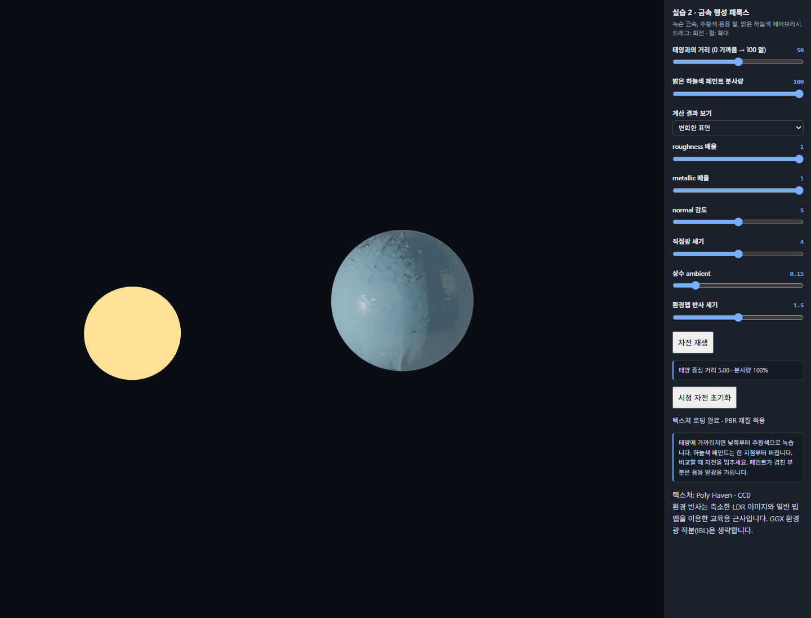 |

분사량 0에서는 페인트가 없고, 50에서는 한 부분을 덮으며, 100에서는 표면 전체를 덮었다. 태양 위치를 바꾸지 않고도 독립적으로 영역이 커졌다.

## 두 흑백 마스크

태양 거리 0, 분사량 50에서 비교했다. 흰색은 변화가 큰 부분, 검정은 변화가 없는 부분이며 회색은 중간값이다.

| 마스크 1 · 용융 | 마스크 2 · 페인트 |
|---|---|
| 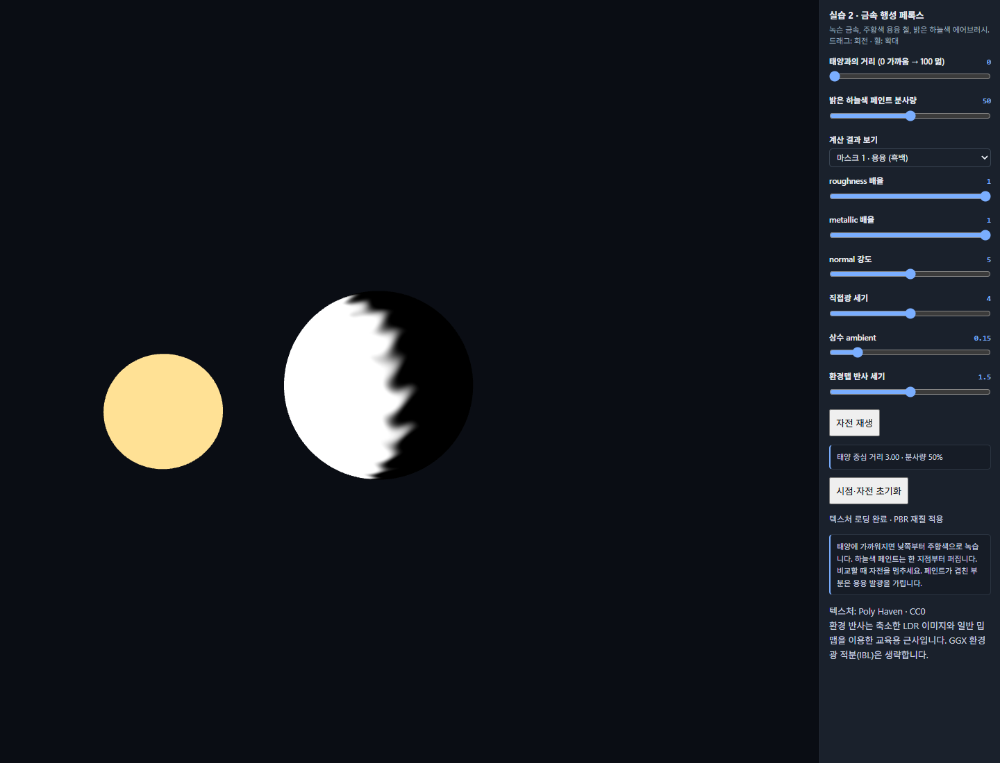 | 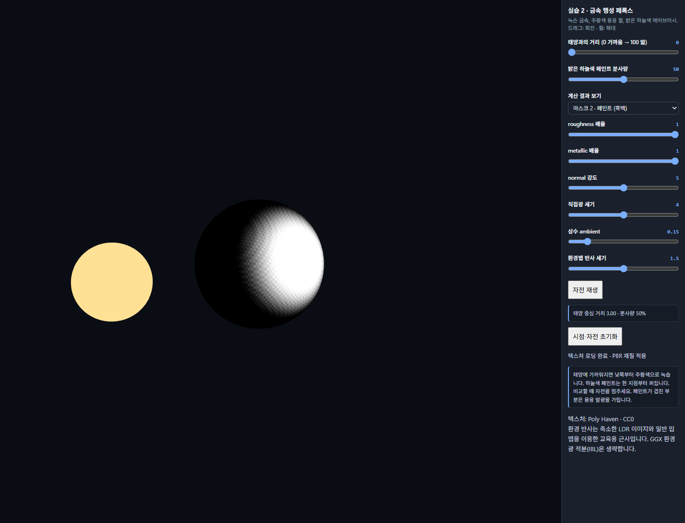 |

용융은 태양 방향을 따라 나타나고, 페인트는 행성 표면의 한 지점을 중심으로 퍼진다. 페인트 마스크는 로컬 좌표로 계산해 자전할 때 표면과 함께 회전한다.

## 기본 표면과 변화한 표면

태양 거리 0, 분사량 50에서 카메라·행성 위치·조명을 유지하고 보기 모드만 전환했다.

| 기본 표면 | 변화한 표면 |
|---|---|
| 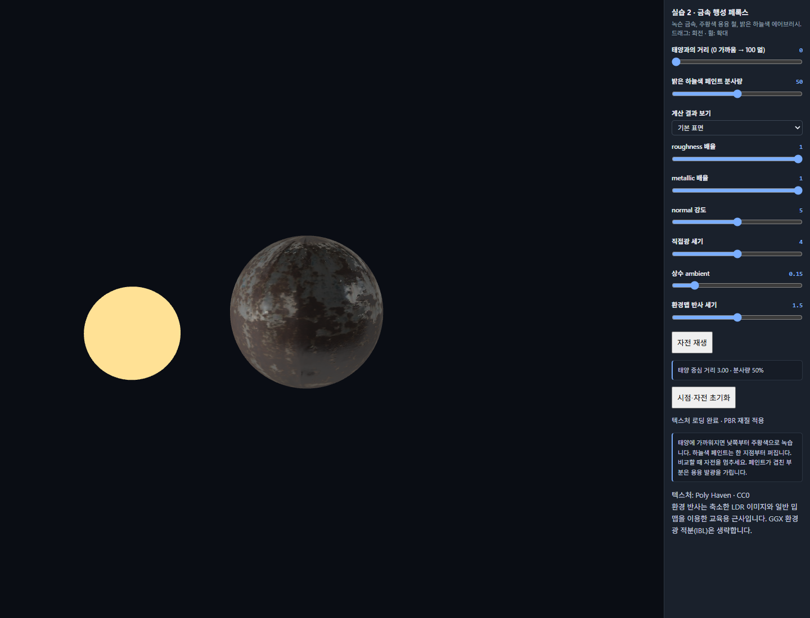 | 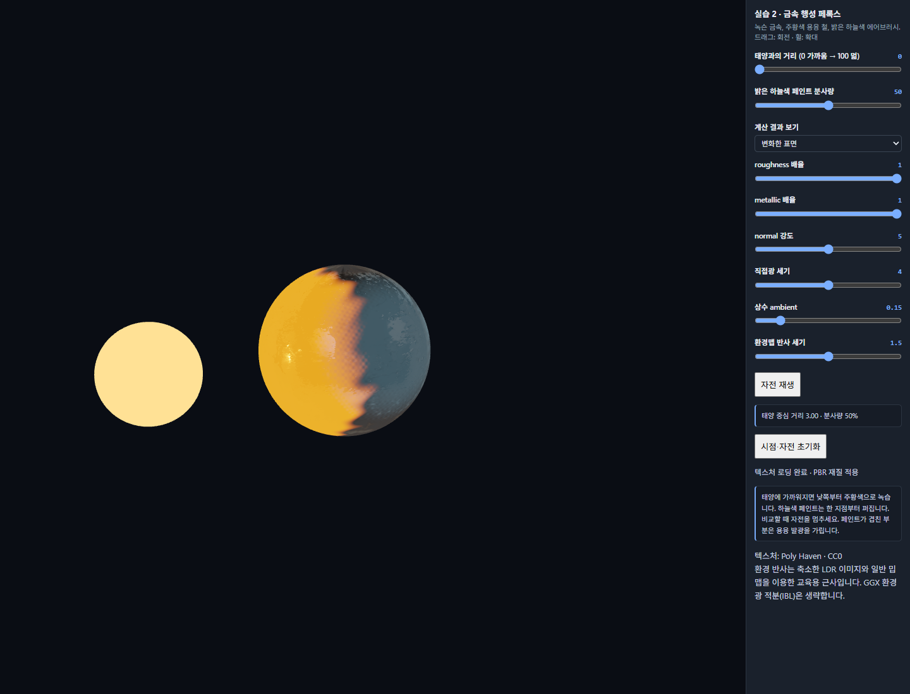 |

기본 표면은 녹과 금속 무늬가 보인다. 변화한 표면은 주황색 용융과 하늘색 도막이 나타나며, 거칠기와 금속성도 달라진다. 법선맵에 의한 요철 명암은 유지되며 구의 외곽선은 바뀌지 않는다.
