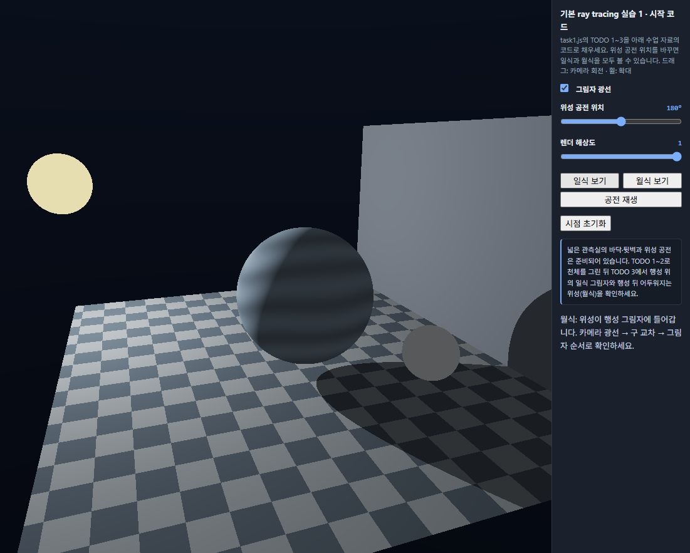

# 7주차 보고서

## 실습 1

## 공전 위치에 따른 일식과 월식

공전 위치를 0°로 맞추면 별–위성–행성 순서로 놓인다. 이때 위성이 별빛을 가려 행성 표면에 둥근 그림자가 생기는 일식을 확인했다.

공전 위치를 180°로 바꾸면 별–행성–위성 순서가 된다. 위성이 행성의 그림자에 들어가 어두워지는 월식을 확인했다. 어두워진 상태에서도 위성의 윤곽은 보였다. 공전 위치는 세 천체의 배치를 바꾸어 어느 천체가 빛을 가리는지 결정한다.

## 그림자 광선의 역할

그림자 광선은 표면과 별 사이에 빛을 가리는 물체가 있는지 확인한다. 이를 끄면 일식에서 행성 위의 위성 그림자가 사라졌고, 월식에서는 어두웠던 위성에 밝은 면이 나타났다. 바닥과 벽의 그림자도 사라졌지만, 표면 방향에 따른 기본적인 명암은 남았다.

## 실습 2: 기기별 렌더링 성능 비교

### 배포 주소와 기기 정보

두 기기에서 같은 GitHub Pages 주소로 측정한다. GPU 정보를 알 수 없으면 ‘확인 불가’로 적는다.

| GitHub Pages의 week7/task2.html 주소 |
| --- |
| |

| 기기 | 종류·모델 | CPU / GPU | 운영체제 | 브라우저·버전 | 전원 상태 |
| --- | --- | --- | --- | --- | --- |
| A | | | | | |
| B | | | | | |

### 공통 조건 반복 측정

조건: **640×360 / 8표본 / 2회 반사 / 고급 효과 켬**. 각 기기에서 3회 측정하고 방식별 중앙값을 구한다. 시간 단위는 ms이며, GPU 실행 시간과 브라우저 동기화 포함 시간은 구분해 기록한다.

| 기기 | 측정 방식 | 회차 | Local (ms) | Ray tracing (ms) | Path tracing (ms) |
| --- | --- | --- | --- | --- | --- |
| A | | 1 | | | |
| A | | 2 | | | |
| A | | 3 | | | |
| A | | 중앙값 | | | |
| B | | 1 | | | |
| B | | 2 | | | |
| B | | 3 | | | |
| B | | 중앙값 | | | |

### 부하 증가 기록

공통 조건에서 한 항목씩 바꾼다. 해상도는 960×540 → 1280×720 → 1920×1080, 표본은 16 → 32, 반사는 3 → 4회를 시험한다. 각 항목 시험 후 나머지 값은 공통 조건으로 되돌린다. 고급 효과 끔/켬도 비교한다. 너무 느리거나 응답하지 않으면 중단하고 관찰란에 적는다. 필요한 만큼 행을 추가한다.

| 기기 | 측정 방식 | 변경 항목 | 조건(해상도 / 표본 / 반사 / 효과) | Local (ms) | Ray tracing (ms) | Path tracing (ms) | 화질·반응·중단 여부 |
| --- | --- | --- | --- | --- | --- | --- | --- |
| A | | | | | | | |
| A | | | | | | | |
| B | | | | | | | |
| B | | | | | | | |

### 기기별 결과 요약

공통 조건에는 위 중앙값을 옮긴다. 고부하는 실제로 시험한 가장 느린 조건, 적정은 아래 허용 시간을 만족하는 조건을 적는다. 측정 방식이 다른 기기의 시간을 직접 비교하지 않는다.

| 기기·브라우저·측정 방식 | 구분 | 조건(해상도 / 표본 / 반사 / 효과) | Local (ms) | Ray tracing (ms) | Path tracing (ms) | 화질·반응 관찰 |
| --- | --- | --- | --- | --- | --- | --- |
| A · | 공통 | 640×360 / 8 / 2 / 켬 | | | | |
| B · | 공통 | 640×360 / 8 / 2 / 켬 | | | | |
| A · | 고부하 | | | | | |
| B · | 고부하 | | | | | |
| A · | 적정 | | | | | |
| B · | 적정 | | | | | |

### 적정 조건 선택과 분석

허용 시간은 어떤 렌더링 방식에 적용하는지도 함께 적는다.

| 기기 | 사용 목적 | 대상 방식·허용 시간(ms) | 선택 조건·시작 렌더링 방식 | 화질·성능을 고려한 선택 이유 |
| --- | --- | --- | --- | --- |
| A | | | | |
| B | | | | |

| 분석 항목 | 관찰 및 이유 |
| --- | --- |
| 공통 조건에서 두 기기의 차이 | |
| 해상도·표본·반사 증가의 영향 | |
| 고급 효과 끔/켬의 차이 | |
| 기기별 적정 설정을 다르게 선택한 이유 | |

### 캡처와 자동 시작 확인

캡처는 `images/`에 저장한다. 접속·자동 시작 화면에는 주소, 적용 설정, 렌더 결과가 보이게 한다. 자동 시작 검증은 실제 측정 결과를 코드에 반영한 뒤 두 기기에서 각각 진행한다.

| 기기 | 캡처 항목 | 이미지 파일명 |
| --- | --- | --- |
| A | GitHub Pages 접속·공통 조건 측정 결과 | |
| B | GitHub Pages 접속·공통 조건 측정 결과 | |
| A | 가장 느리게 시험한 조건의 화면·설정·시간 | |
| B | 가장 느리게 시험한 조건의 화면·설정·시간 | |
| A | 적정 조건의 화질·설정·측정 결과 | |
| B | 적정 조건의 화질·설정·측정 결과 | |
| A | 새로고침 직후 자동 선택된 설정·렌더 화면 | |
| B | 새로고침 직후 자동 선택된 설정·렌더 화면 | |

| 기기 | 자동 선택 기준·저장 방법 | 새로고침 후 적용 설정·렌더링 방식 | 수동 변경 없이 적용됨 |
| --- | --- | --- | --- |
| A | | | |
| B | | | |
