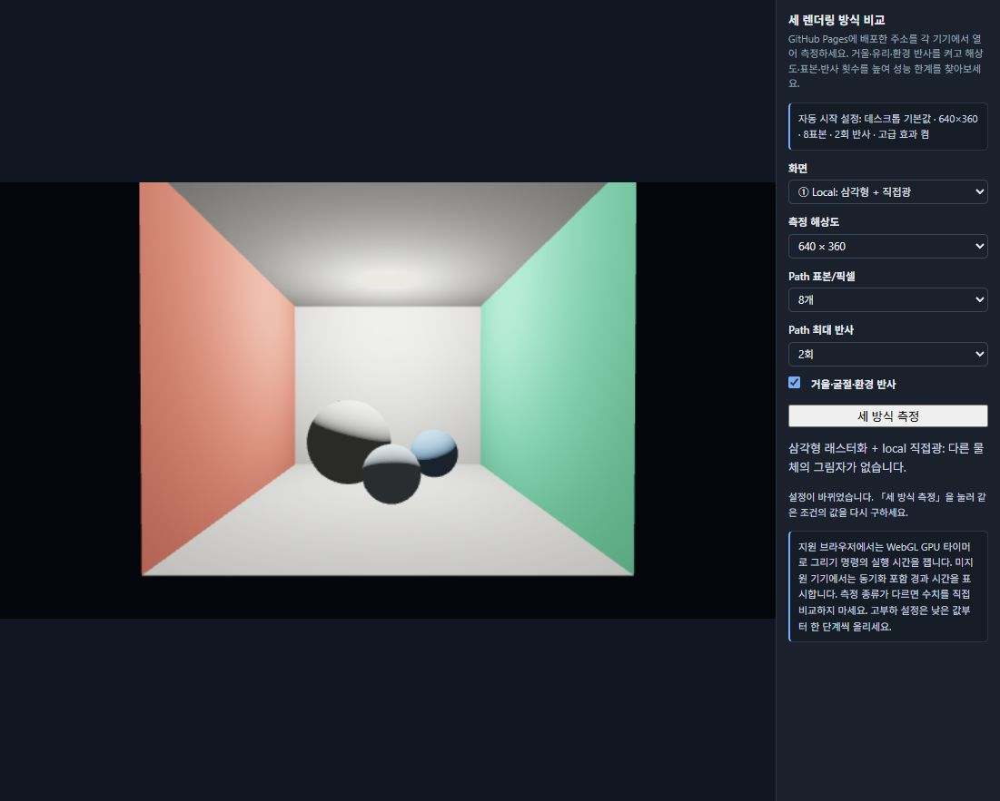
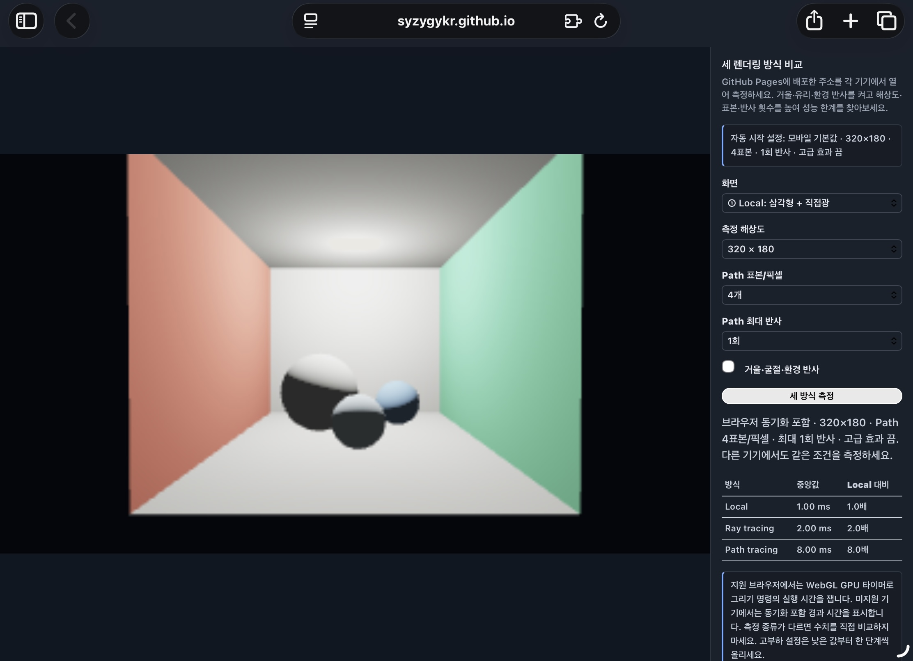

# 7주차 보고서

## 실습 1

## 공전 위치에 따른 일식과 월식

공전 위치를 0°로 맞추면 별–위성–행성 순서로 놓인다. 이때 위성이 별빛을 가려 행성 표면에 둥근 그림자가 생기는 일식을 확인했다.

공전 위치를 180°로 바꾸면 별–행성–위성 순서가 된다. 위성이 행성의 그림자에 들어가 어두워지는 월식을 확인했다. 어두워진 상태에서도 위성의 윤곽은 보였다. 공전 위치는 세 천체의 배치를 바꾸어 어느 천체가 빛을 가리는지 결정한다.

## 그림자 광선의 역할

그림자 광선은 표면과 별 사이에 빛을 가리는 물체가 있는지 확인한다. 이를 끄면 일식에서 행성 위의 위성 그림자가 사라졌고, 월식에서는 어두웠던 위성에 밝은 면이 나타났다. 바닥과 벽의 그림자도 사라졌지만, 표면 방향에 따른 기본적인 명암은 남았다.

## 실습 2: 기기별 렌더링 성능 비교

### 배포 주소와 기기 정보

두 기기에서 같은 GitHub Pages 주소로 측정한다. GPU 정보를 알 수 없으면 ‘확인 불가’로 적는다.

| GitHub Pages의 week7/task2.html 주소 |
| --- |
| https://syzygykr.github.io/cg-2026-solar-syzygykr/week7/task2.html |

| 기기 | 종류·모델 | CPU / GPU | 운영체제 | 브라우저·버전 | 전원 상태 |
| --- | --- | --- | --- | --- | --- |
| A | Laptop | intel core i7 / MX450 | Windows11 | Chrome | 충전 중 |
| B | iPad | 확인 불가 / 확인 불가 | iPad OS | Safari | 배터리 |

### 공통 조건 반복 측정

조건: **640×360 / 8표본 / 2회 반사 / 고급 효과 켬**. 각 기기에서 3회 측정하고 방식별 중앙값을 구한다. 시간 단위는 ms이며, GPU 실행 시간과 브라우저 동기화 포함 시간은 구분해 기록한다.

| 기기 | 측정 방식 | 회차 | Local (ms) | Ray tracing (ms) | Path tracing (ms) |
| --- | --- | --- | --- | --- | --- |
| A | GPU 실행 시간 | 1 | 0.14 | 0.20 | 4.18 |
| A | GPU 실행 시간 | 2 | 0.14 | 0.18 | 3.87 |
| A | GPU 실행 시간 | 3 | 0.07 | 0.14 | 3.14 |
| A | GPU 실행 시간 | 중앙값 | 0.14 | 0.18 | 3.87 |
| B | GPU 실행 시간 | 1 | 1.00 | 4.00 | 27.00 |
| B | GPU 실행 시간 | 2 | 2.00 | 4.00 | 27.00 |
| B | GPU 실행 시간 | 3 | 2.00 | 5.00 | 26.00 |
| B | GPU 실행 시간 | 중앙값 | 2.00 | 4.00 | 27.00 |

### 부하 증가 기록

| 기기 | 측정 방식 | 변경 항목 | 조건(해상도 / 표본 / 반사 / 효과) | Local (ms) | Ray tracing (ms) | Path tracing (ms) | 화질·반응·중단 여부 |
| --- | --- | --- | --- | --- | --- | --- | --- |
| A | GPU 실행 시간 | 해상도 | 960×540 / 8 / 2 / 켬 | 0.49 | 0.47 | 10.47 | 측정 완료·응답 중단 없음 |
| A | GPU 실행 시간 | 해상도 | 1280×720 / 8 / 2 / 켬 | 0.19 | 0.36 | 8.19 | 측정 완료·응답 중단 없음 |
| A | GPU 실행 시간 | 해상도 | 1920×1080 / 8 / 2 / 켬 | 0.40 | 0.77 | 17.87 | 측정 완료·응답 중단 없음 |
| A | GPU 실행 시간 | 표본 | 640×360 / 16 / 2 / 켬 | 0.14 | 0.30 | 12.04 |  |
| A | GPU 실행 시간 | 표본 | 640×360 / 32 / 2 / 켬 | 0.06 | 0.10 | 8.57 |  |
| A | GPU 실행 시간 | 반사 | 640×360 / 8 / 3 / 켬 | 0.06 | 0.10 | 2.93 | 측정 완료·응답 중단 없음 |
| A | GPU 실행 시간 | 반사 | 640×360 / 8 / 4 / 켬 | 0.06 | 0.10 | 3.71 | 3회보다 Path 시간 증가 |
| A | GPU 실행 시간 | 고급 효과 | 640×360 / 8 / 2 / 끔 | 0.14 | 0.20 | 4.66 |  |
| A | GPU 실행 시간 | 복합 고부하 | 1920×1080 / 32 / 4 / 켬 | 0.38 | 0.59 | 95.29 |  |
| A | GPU 실행 시간 | 적정 후보 | 1280×720 / 16 / 3 / 켬 | 0.18 | 0.27 | 16.69 |  |
| A | GPU 실행 시간 | 적정 경계·표본 | 1280×720 / 32 / 4 / 켬 | 0.18 | 0.27 | 42.40 |  |
| A | GPU 실행 시간 | 적정 경계·해상도 | 1920×1080 / 16 / 4 / 켬 | 0.38 | 0.59 | 47.64 |  |
| B | GPU 실행 시간 | 해상도 | 960×540 / 8 / 2 / 켬 | 2.0 | 10.0 | 55.0 | 측정 완료·응답 중단 없음 |
| B | GPU 실행 시간 | 해상도 | 1280×720 / 8 / 2 / 켬 | 2.0 | 9.0 | 93.0 | 측정 완료·응답 중단 없음 |
| B | GPU 실행 시간 | 해상도 | 1920×1080 / 8 / 2 / 켬 | 3.0 | 21.0 | 208.0 | 측정 완료·응답 중단 없음 |
| B | GPU 실행 시간 | 표본 | 640×360 / 16 / 2 / 켬 | 1.0 | 6.0 | 50.0 |  |
| B | GPU 실행 시간 | 표본 | 640×360 / 32 / 2 / 켬 | 2.0 | 5.0 | 95.00 |  |
| B | GPU 실행 시간 | 반사 | 640×360 / 8 / 3 / 켬 | 2.0 | 6.0 | 35.0 | 측정 완료·응답 중단 없음 |
| B | GPU 실행 시간 | 반사 | 640×360 / 8 / 4 / 켬 | 2.0 | 6.0 | 43.0 | 3회보다 Path 시간 증가 |
| B | GPU 실행 시간 | 고급 효과 | 640×360 / 8 / 2 / 끔 | 1.0 | 5.0 | 27.0 |  |
| B | GPU 실행 시간 | 복합 고부하 | 1920×1080 / 32 / 4 / 켬 | 5.0 | 19.0 | 1391.0 | 최악 |
| B | GPU 실행 시간 | 적정 후보 | 1280×720 / 16 / 3 / 켬 | 2.0 | 10.0 | 251.0 |  |
| B | GPU 실행 시간 | 적정 경계·표본 | 1280×720 / 32 / 4 / 켬 | 3.0 | 12.0 | 625.0 |  |
| B | GPU 실행 시간 | 적정 경계·해상도 | 1920×1080 / 16 / 4 / 켬 | 4.0 | 15.0 | 703.0 | 모바일의 확실한 열세 |

### 결과 요약과 적정 조건

| 기기·측정 방식 | 구분 | 조건(해상도 / 표본 / 반사 / 효과) | Local (ms) | Ray tracing (ms) | Path tracing (ms) |
| --- | --- | --- | --- | --- | --- |
| A · Chrome · GPU | 공통 | 640×360 / 8 / 2 / 켬 | 0.14 | 0.18 | 3.87 |
| B · Safari · GPU | 공통 | 640×360 / 8 / 2 / 켬 | 2.00 | 4.00 | 27.00 |
| A · Chrome · GPU | 고부하 | 1920×1080 / 32 / 4 / 켬 | 0.38 | 0.59 | 95.29 |
| B · Safari · GPU | 고부하 | 1920×1080 / 32 / 4 / 켬 | 5.00 | 19.00 | 1391.00 |
| A · Chrome · GPU | 적정 | 1280×720 / 16 / 4 / 켬 | 0.18 | 0.27 | 21.11 |
| B · Safari · GPU | 적정 | 640×360 / 8 / 2 / 켬 | 2.00 | 4.00 | 27.00 |

### 캡처와 자동 시작 확인

