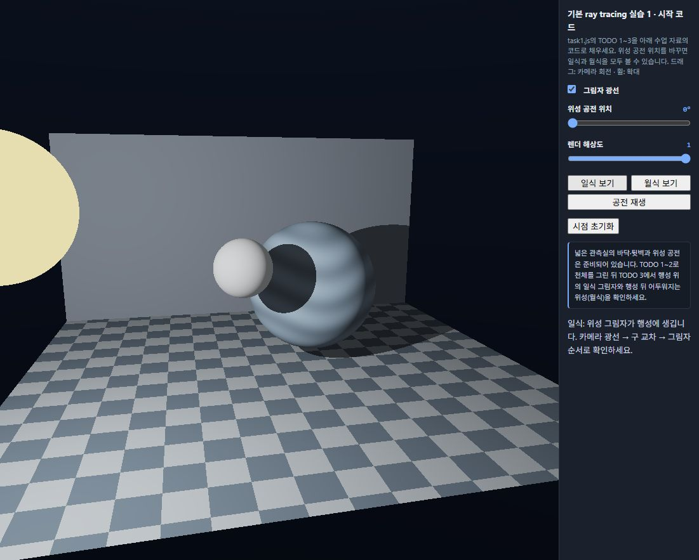
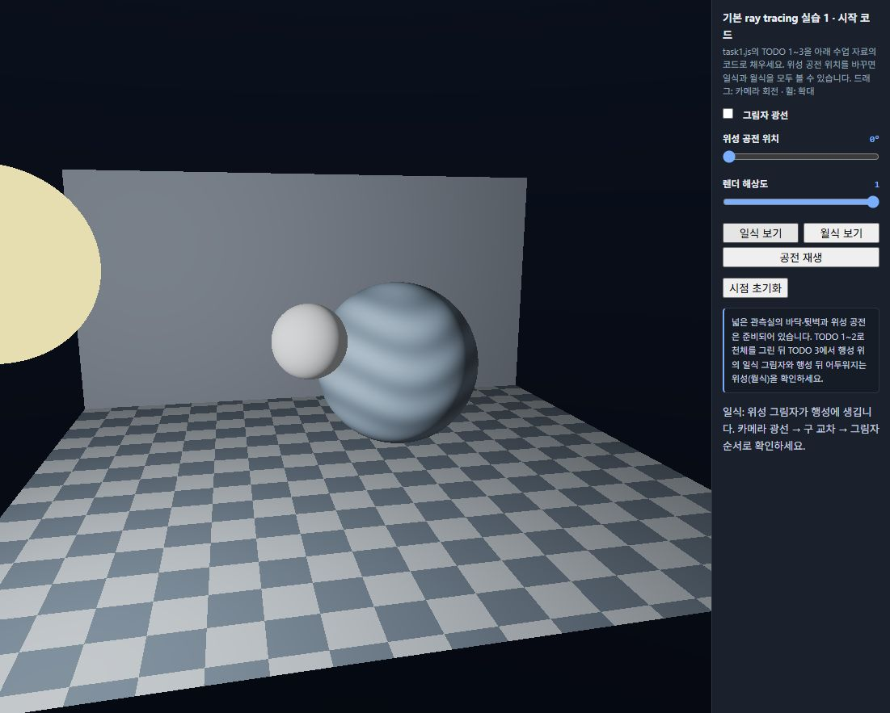
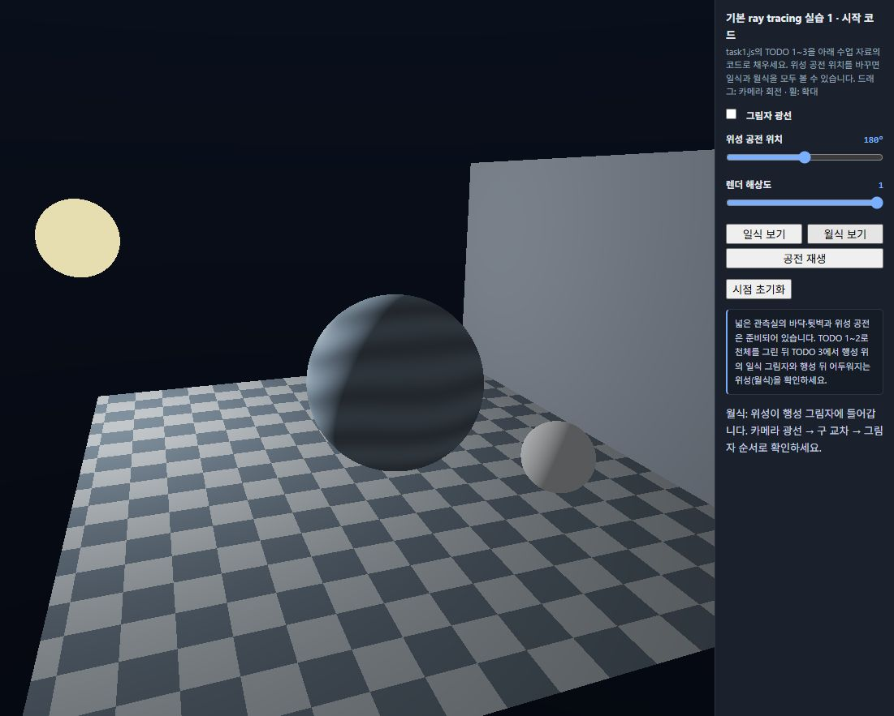
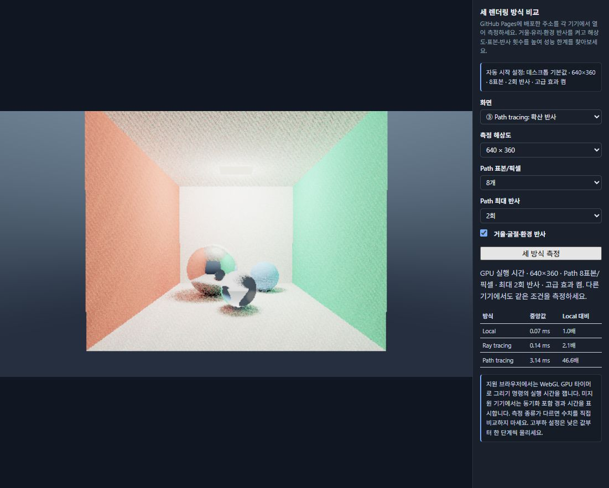
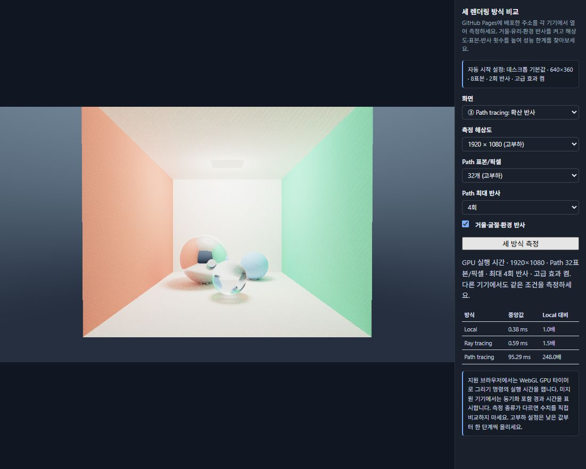
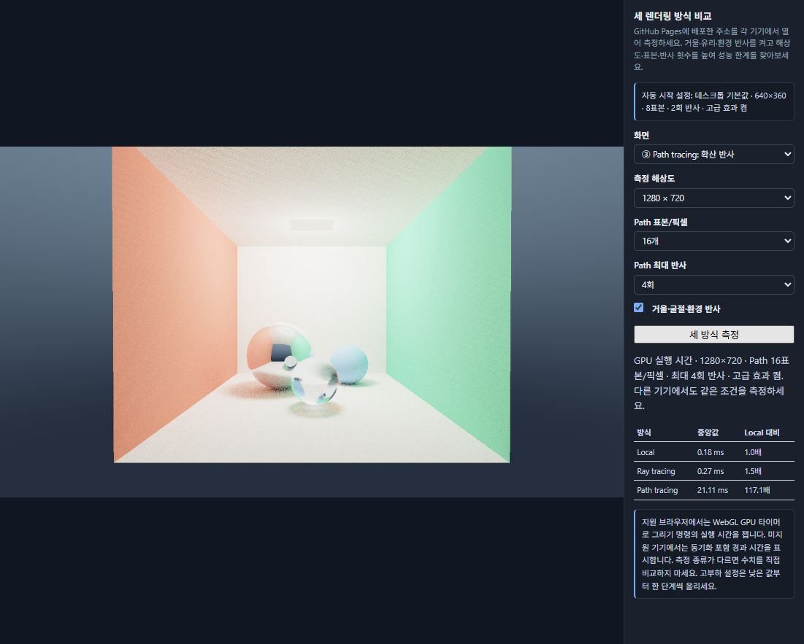

# 7주차 보고서

## 실습 1

## 공전 위치에 따른 일식과 월식

공전 위치를 0°로 맞추면 별–위성–행성 순서로 놓인다. 이때 위성이 별빛을 가려 행성 표면에 둥근 그림자가 생기는 일식을 확인했다.

공전 위치를 180°로 바꾸면 별–행성–위성 순서가 된다. 위성이 행성의 그림자에 들어가 어두워지는 월식을 확인했다. 어두워진 상태에서도 위성의 윤곽은 보였다. 공전 위치는 세 천체의 배치를 바꾸어 어느 천체가 빛을 가리는지 결정한다.

## 그림자 광선의 역할

그림자 광선은 표면과 별 사이에 빛을 가리는 물체가 있는지 확인한다. 이를 끄면 일식에서 행성 위의 위성 그림자가 사라졌고, 월식에서는 어두웠던 위성에 밝은 면이 나타났다. 바닥과 벽의 그림자도 사라졌지만, 표면 방향에 따른 기본적인 명암은 남았다.

## 실습 2: 기기별 렌더링 성능 비교

### 배포 주소와 기기 정보

두 기기에서 같은 GitHub Pages 주소로 측정한다. GPU 정보를 알 수 없으면 ‘확인 불가’로 적는다.

| GitHub Pages의 week7/task2.html 주소 |
| --- |
| https://syzygykr.github.io/cg-2026-solar-syzygykr/week7/task2.html |

| 기기 | 종류·모델 | CPU / GPU | 운영체제 | 브라우저·버전 | 전원 상태 |
| --- | --- | --- | --- | --- | --- |
| A | Codex 내장 브라우저 실행 환경(실제 모델 확인 불가) | 확인 불가 / 확인 불가 | 확인 불가 | Codex 내장 브라우저·버전 확인 불가 | 확인 불가 |
| B | | | | | |

### 공통 조건 반복 측정

조건: **640×360 / 8표본 / 2회 반사 / 고급 효과 켬**. 각 기기에서 3회 측정하고 방식별 중앙값을 구한다. 시간 단위는 ms이며, GPU 실행 시간과 브라우저 동기화 포함 시간은 구분해 기록한다.

| 기기 | 측정 방식 | 회차 | Local (ms) | Ray tracing (ms) | Path tracing (ms) |
| --- | --- | --- | --- | --- | --- |
| A | GPU 실행 시간 | 1 | 0.14 | 0.20 | 4.18 |
| A | GPU 실행 시간 | 2 | 0.14 | 0.18 | 3.87 |
| A | GPU 실행 시간 | 3 | 0.07 | 0.14 | 3.14 |
| A | GPU 실행 시간 | 중앙값 | 0.14 | 0.18 | 3.87 |
| B | | 1 | | | |
| B | | 2 | | | |
| B | | 3 | | | |
| B | | 중앙값 | | | |

### 부하 증가 기록

공통 조건에서 한 항목씩 바꾼다. 해상도는 960×540 → 1280×720 → 1920×1080, 표본은 16 → 32, 반사는 3 → 4회를 시험한다. 각 항목 시험 후 나머지 값은 공통 조건으로 되돌린다. 고급 효과 끔/켬도 비교한다. 너무 느리거나 응답하지 않으면 중단하고 관찰란에 적는다. 필요한 만큼 행을 추가한다.

| 기기 | 측정 방식 | 변경 항목 | 조건(해상도 / 표본 / 반사 / 효과) | Local (ms) | Ray tracing (ms) | Path tracing (ms) | 화질·반응·중단 여부 |
| --- | --- | --- | --- | --- | --- | --- | --- |
| A | GPU 실행 시간 | 해상도 | 960×540 / 8 / 2 / 켬 | 0.49 | 0.47 | 10.47 | 측정 완료·응답 중단 없음 |
| A | GPU 실행 시간 | 해상도 | 1280×720 / 8 / 2 / 켬 | 0.19 | 0.36 | 8.19 | 측정 완료·응답 중단 없음 |
| A | GPU 실행 시간 | 해상도 | 1920×1080 / 8 / 2 / 켬 | 0.40 | 0.77 | 17.87 | 측정 완료·응답 중단 없음 |
| A | GPU 실행 시간 | 표본 | 640×360 / 16 / 2 / 켬 | 0.14 | 0.30 | 12.04 | 반복 측정 변동에 주의 |
| A | GPU 실행 시간 | 표본 | 640×360 / 32 / 2 / 켬 | 0.06 | 0.10 | 8.57 | 표본 증가 시 노이즈 완화, 단회 수치 역전 발생 |
| A | GPU 실행 시간 | 반사 | 640×360 / 8 / 3 / 켬 | 0.06 | 0.10 | 2.93 | 측정 완료·응답 중단 없음 |
| A | GPU 실행 시간 | 반사 | 640×360 / 8 / 4 / 켬 | 0.06 | 0.10 | 3.71 | 3회보다 Path 시간 증가 |
| A | GPU 실행 시간 | 고급 효과 | 640×360 / 8 / 2 / 끔 | 0.14 | 0.20 | 4.66 | 시간 차이는 측정 변동 범위와 겹침 |
| A | GPU 실행 시간 | 복합 고부하 | 1920×1080 / 32 / 4 / 켬 | 0.38 | 0.59 | 95.29 | 응답 중단은 없지만 33.3ms 기준 초과 |
| A | GPU 실행 시간 | 적정 후보 | 1280×720 / 16 / 3 / 켬 | 0.18 | 0.27 | 16.69 | 3회 측정 중앙값 |
| A | GPU 실행 시간 | 적정 경계·표본 | 1280×720 / 32 / 4 / 켬 | 0.18 | 0.27 | 42.40 | 33.3ms 기준 초과 |
| A | GPU 실행 시간 | 적정 경계·해상도 | 1920×1080 / 16 / 4 / 켬 | 0.38 | 0.59 | 47.64 | 33.3ms 기준 초과 |
| B | | | | | | | |
| B | | | | | | | |

### 기기별 결과 요약

공통 조건에는 위 중앙값을 옮긴다. 고부하는 실제로 시험한 가장 느린 조건, 적정은 아래 허용 시간을 만족하는 조건을 적는다. 측정 방식이 다른 기기의 시간을 직접 비교하지 않는다.

| 기기·브라우저·측정 방식 | 구분 | 조건(해상도 / 표본 / 반사 / 효과) | Local (ms) | Ray tracing (ms) | Path tracing (ms) | 화질·반응 관찰 |
| --- | --- | --- | --- | --- | --- | --- |
| A · Codex 내장 · GPU | 공통 | 640×360 / 8 / 2 / 켬 | 0.14 | 0.18 | 3.87 | Path 화면에 노이즈가 보임 |
| B · | 공통 | 640×360 / 8 / 2 / 켬 | | | | |
| A · Codex 내장 · GPU | 고부하 | 1920×1080 / 32 / 4 / 켬 | 0.38 | 0.59 | 95.29 | 노이즈는 줄지만 조작용 시간 기준 초과 |
| B · | 고부하 | | | | | |
| A · Codex 내장 · GPU | 적정 | 1280×720 / 16 / 4 / 켬 | 0.18 | 0.27 | 21.11 | 거울·유리·간접광을 유지하고 시간 기준 충족 |
| B · | 적정 | | | | | |

### 적정 조건 선택과 분석

허용 시간은 어떤 렌더링 방식에 적용하는지도 함께 적는다.

| 기기 | 사용 목적 | 대상 방식·허용 시간(ms) | 선택 조건·시작 렌더링 방식 | 화질·성능을 고려한 선택 이유 |
| --- | --- | --- | --- | --- |
| A | 설정을 자주 바꾸며 비교하는 화면 | Path tracing GPU 실행 시간 33.3ms 이하 | 1280×720 / 16 / 4 / 켬 · Path tracing | 공통 조건보다 해상도와 표본을 높였다. 표본 또는 해상도를 한 단계 더 높이면 시간 기준을 넘었다. |
| B | | | | |

| 분석 항목 | 관찰 및 이유 |
| --- | --- |
| 공통 조건에서 두 기기의 차이 | |
| 해상도·표본·반사 증가의 영향 | A에서 최대 복합 조건은 Path 95.29ms였다. 적정 조건은 3회 측정에서 27.80 / 21.11 / 21.11ms였고, 중앙값은 21.11ms였다. 해상도나 표본을 더 올린 인접 조건은 42.40~47.64ms로 기준을 넘었다. |
| 고급 효과 끔/켬의 차이 | Local은 직접광만 사용하고, Ray·Path는 켰을 때 거울 반사와 유리 굴절을 계산한다. 공통 조건의 Path는 켬 3.87ms, 끔 4.66ms로 오히려 역전되어 이번 수치만으로 효과의 추가 비용을 단정하지 않았다. |
| 기기별 적정 설정을 다르게 선택한 이유 | |

### 캡처와 자동 시작 확인

캡처는 `images/`에 저장한다. 접속·자동 시작 화면에는 주소, 적용 설정, 렌더 결과가 보이게 한다. 자동 시작 검증은 실제 측정 결과를 코드에 반영한 뒤 두 기기에서 각각 진행한다.

| 기기 | 캡처 항목 | 이미지 파일명 |
| --- | --- | --- |
| A | GitHub Pages 접속·공통 조건 측정 결과 | 실습2-기기A-공통조건.png |
| B | GitHub Pages 접속·공통 조건 측정 결과 | |
| A | 가장 느리게 시험한 조건의 화면·설정·시간 | 실습2-기기A-고부하.png |
| B | 가장 느리게 시험한 조건의 화면·설정·시간 | |
| A | 적정 조건의 화질·설정·측정 결과 | 실습2-기기A-적정조건.png |
| B | 적정 조건의 화질·설정·측정 결과 | |
| A | 새로고침 직후 상태(적정 조건 자동 적용 전) | 실습2-기기A-새로고침-기본값.png |
| B | 새로고침 직후 자동 선택된 설정·렌더 화면 | |

| 기기 | 자동 선택 기준·저장 방법 | 새로고침 후 적용 설정·렌더링 방식 | 수동 변경 없이 적용됨 |
| --- | --- | --- | --- |
| A | 시작 코드의 데스크톱 기본값, 적정 조건 저장 기능 미구현 | 640×360 / 8 / 2 / 켬 · Local | 미완료: 선택한 적정 조건으로 돌아오지 않음 |
| B | | | |

기기 A는 2026-11-17에 위 Pages 주소에서 측정했다. 각 버튼 실행은 준비 1회 후 5회 측정의 중앙값을 표시한다. 공통·적정 조건은 버튼을 3회 실행한 뒤 다시 방식별 중앙값을 구했다. 초기 워밍업 후에도 값이 변했고 일부 단회 부하 측정에서 순서가 역전되어, 작은 차이를 성능 향상으로 해석하지 않았다. GPU 시간은 전체 화면 응답 시간이나 실제 FPS와 같지 않다. 캡처의 수치는 마지막 회차이며 요약 표는 중앙값이다.

아래 캡처는 동일한 Pages 탭의 페이지 영역이다. 주소창은 포함되지 않으므로 제출용 주소 증빙은 주소창이 보이는 화면을 별도로 보완해야 한다. 기기 A의 실제 하드웨어 정보도 제출 전에 확인이 필요하다.

